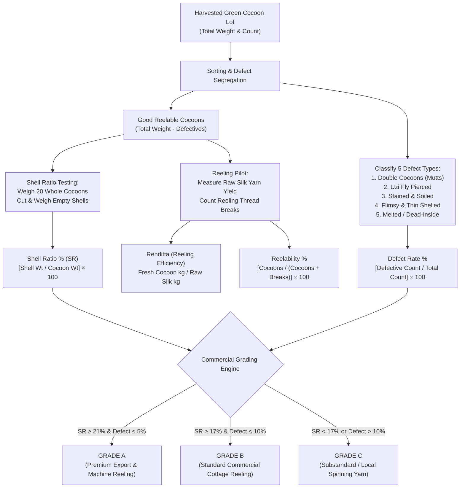
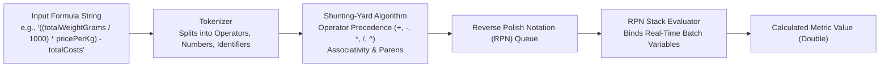
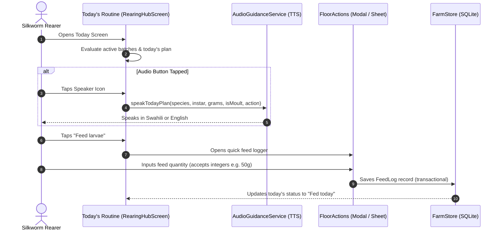

# KALRO Sericulture Farm Management System
## Comprehensive System Architecture, Domain Science & Engineering Overview

---

### Executive Summary

The **KALRO Sericulture Management System** is a mission-critical, offline-first mobile and web application suite developed for silkworm rearers, sericulture technicians, and extension officers in Kenya. Produced in collaboration with the **Kenya Agricultural and Livestock Research Organization (KALRO)**, the system digitizes the entire sericulture value chain—from egg incubation and larval instar feeding to disease mitigation, cocoon harvesting, commercial reeling analytics, and market grading.

Sericulture in East Africa operates under unique agricultural conditions: rearing sheds are situated in rural environments with intermittent or non-existent cellular connectivity; farmers operate with budget Android smartphones or basic touch devices; ambient outdoor temperatures and relative humidity directly govern larval biology; and farmers handle delicate caterpillars, damp leaves, and disinfectants, making complex phone interactions impractical.

To address these conditions, this platform combines:
1. **Mathematical Biological Modeling** for *Bombyx mori* (Mulberry silkworm) and *Samia cynthia ricini* (Eri silkworm).
2. **Commercial Cocoon Reeling & Quality Analytics** (Renditta, Shell Ratio, Defect Rate, Reelability, KALRO Grade A/B/C classification).
3. **Leaf Inventory Velocity & Runout Forecasting** across Mulberry, Castor, and Kesseru forages.
4. **Hands-Free Bilingual Voice Guidance** (English & Kiswahili) via Text-to-Speech (TTS).
5. **Zero-Cloud, Fully Transactional Local Storage** (`FarmStore` SQLite and Multi-Tenant IndexedDB) with cryptographic JSON backups and multi-sheet offline Excel (`.xlsx`) reporting.
6. **Minimalist, High-Contrast Sunlight-Calibrated UI** designed to avoid cognitive overload and facilitate single-handed floor operations.

---

## 1. System Architecture & Dual-Platform Design

The platform consists of two interoperable implementations sharing identical domain rules, data structures, and mathematical formulas:
- **Mobile Client**: Native Flutter (Dart 3.x / Flutter 3.16+) targeted at Android, iOS, Linux, and Windows.
- **Web Client**: Progressive Web App (React 19 + TypeScript + Vite) targeted at desktop workstations, research station computers, and mobile browsers.

```mermaid
flowchart TD
    subgraph UI_Layer ["Presentation & Ergonomics"]
        MobileApp["Flutter Mobile Application (Android / iOS / Desktop)"]
        WebApp["React 19 + TypeScript PWA (Vite / Responsive)"]
        TTS["Bilingual TTS Voice Guidance (EN / SW)"]
        QR["Batch Tray QR Scanner & Generator"]
    end

    subgraph Domain_Layer ["Sericultural Domain & Calculation Engines"]
        LifecycleEngine["Biological Lifecycle Engine\n(Bombyx & Eri Instar Timelines)"]
        ReelingEngine["Cocoon Analytics & Grading\n(Renditta, Shell %, ERR, Grade A/B/C)"]
        LeafLedger["Forage Inventory & Runout Forecaster\n(Mulberry / Castor / Kesseru)"]
        FormulaEngine["Mathematical Formula Engine\n(Shunting-Yard RPN Parser)"]
        AlertsEngine["Climate & Health Alert Service\n(Temperature, RH%, Mortality, Moult)"]
    end

    subgraph Data_Layer ["Offline-First Persistence & Interchange"]
        SQLite["FarmStore (Transactional SQLite with Indexed JSON Queries)"]
        IDB["IndexedDB + LocalStorage Fallback (Tenant Isolated)"]
        Excel["Multi-Sheet Excel Export (6 Sheets .xlsx)"]
        PDF["Vector PDF Reports (jspdf / pdf)"]
        Backup["Cryptographic JSON Backup & Restore (SHA-256)"]
    end

    MobileApp --> LifecycleEngine
    MobileApp --> ReelingEngine
    MobileApp --> LeafLedger
    MobileApp --> FormulaEngine
    MobileApp --> AlertsEngine
    MobileApp --> TTS
    MobileApp --> QR
    MobileApp --> SQLite
    MobileApp --> Excel
    MobileApp --> Backup

    WebApp --> LifecycleEngine
    WebApp --> ReelingEngine
    WebApp --> LeafLedger
    WebApp --> FormulaEngine
    WebApp --> AlertsEngine
    WebApp --> QR
    WebApp --> IDB
    WebApp --> PDF
    WebApp --> Backup
```



### Technology Matrix

| Component | Flutter Mobile App | React Web PWA | Purpose & Responsibility |
|---|---|---|---|
| **Core Framework** | Flutter 3.16+ / Dart 3.11+ | React 19.3+ / TypeScript 7.x | Primary presentation and application lifecycle |
| **Build & Bundler** | Flutter Build Tools / Gradle | Vite 8.3+ | Code compilation, tree shaking, minification |
| **Local Storage** | `sqlite3` + `sqlite3_flutter_libs` | `IndexedDB` (`IDBDatabase`) + `localStorage` | 100% offline, durable ACID transactions |
| **Spreadsheets** | `excel: ^4.0.6` | CSV / Structured JSON exports | 6-sheet offline `.xlsx` generation |
| **Document Export** | `pdf: ^3.11.3` + `printing` | `jspdf` + `jspdf-autotable` | Field records and performance certificate generation |
| **Hardware & IoT** | `qr_flutter: ^4.1.0`, `image_picker` | `qrcode.react`, Camera Web API | Batch tray and Chandrike physical QR tracking |
| **Audio Synthesis** | `flutter_tts: ^4.2.5` | Web Speech Synthesis API | Hands-free voice guidance in Swahili and English |
| **Charts & Graphs** | `fl_chart: ^0.70.2` | SVG / Canvas Vector Engines | Growth curves, feed trends, defect breakdown |
| **Localization** | `flutter_localizations` & `intl` | `translations.ts` dictionary | English & Kiswahili full system parity |
| **Testing** | 113 Automated Unit & Widget Tests | Oxlint + TypeScript type verification | Zero-regression quality assurance |

---

## 2. Biological Lifecycle Modeling & Predictive Scheduling

The application models the complex metamorphosis of silkworms through two distinct biological engine configurations based on KALRO technical manuals.

### 2.1 *Bombyx mori* (Mulberry Silkworm)

*Bombyx mori* is a monophagous domesticated insect that feeds exclusively on fresh leaves of the white or black mulberry tree (*Morus alba*, *Morus indica*). It completes its larval cycle through 5 distinct growth instars separated by 4 dormant moults, spinning a sealed silk cocoon containing a single continuous fibroin filament.

```mermaid
graph LR
    Incub["Incubation\n(10-12 days)\n25°C, 80% RH"] --> I1["1st Instar\n(3 days)\nTender Chopped Leaf"]
    I1 --> M1["1st Moult\n(1 rest day)\nFeed Cutoff"]
    M1 --> I2["2nd Instar\n(3 days)\nChopped Leaf"]
    I2 --> M2["2nd Moult\n(1 rest day)\nFeed Cutoff"]
    M2 --> I3["3rd Instar\n(3 days)\nChawki / Transition"]
    I3 --> M3["3rd Moult\n(1 rest day)\nFeed Cutoff"]
    M3 --> I4["4th Instar\n(3 days)\nWhole Leaf / Shoot"]
    I4 --> M4["4th Moult\n(1 rest day)\nFinal Cutoff"]
    M4 --> I5["5th Instar\n(6-7 days)\nVoracious Feeding"]
    I5 --> Mount["Mounting\n(1 day)\nTransfer to Chandrike"]
    Mount --> Spin["Spinning\n(3-5 days)\nCocoon Construction"]
    Spin --> Harv["Cocoon Harvest\n(Day 38-40)\nSorting & Reeling"]
    Harv --> Moth["Moth Emergence\n(Day 52-54)\nEgg Production"]
```



#### Detailed Stage Calendar:
1. **Egg Incubation (10–12 days)**: Eggs are kept in black boxing and controlled rearing conditions (25°C, 80% RH). Feed policy: `FeedPolicy.none`.
2. **1st Instar (3 days)**: Young chawki worms fed tender, finely chopped (0.5–1.0 cm) top mulberry leaves 3–4 times daily. High moisture retention required.
3. **1st Moult (1 day)**: Worms shed head capsules and cuticles. Complete feed cutoff (`FeedPolicy.none`). Farmers apply slaked lime or bed disinfectants (e.g., Vijetha/Labex).
4. **2nd Instar (3 days)**: Medium chopped leaf (1–2 cm), bed spacing expanded $2\times$.
5. **2nd Moult (1 day)**: Absolute rest. Larvae remain motionless with heads raised.
6. **3rd Instar (3 days)**: Transition to late-stage rearing. Larval appetite accelerates.
7. **3rd Moult (1 day)**: Third skin shed. Bed cleaning performed prior to settling.
8. **4th Instar (3 days)**: Fed whole leaves or shoot feeding. Leaf demand escalates rapidly.
9. **4th Moult (1 day)**: Final moult rest. Rearing floor prepared for peak leaf intake.
10. **5th Instar (6–7 days)**: Consumes over 80% of total lifetime forage. Larvae increase weight by over 10,000-fold from hatching.
11. **Mounting (1 day)**: Mature worms exhibit ripe translucent amber/creamy coloration, stop feeding, void soft gut contents, and raise heads looking for anchor points. Placed on rotary mountages or woven bamboo *Chandrikes*.
12. **Spinning (3–5 days)**: Larva secretes liquid silk from twin sericteries through the spinneret, drawing out a single bave up to 1,500 meters long, hardening into a cocoon.
13. **Cocoon Harvest Window (Days 38–40)**: Cocoons harvested 6–8 days after mounting starts, prior to pupal transformation and moth emergence.
14. **Moth Emergence (Days 52–54)**: If unharvested/stifled, moths excrete alkaline proteases that dissolve cocoon shells, destroying silk commercial reelability.

---

### 2.2 *Samia cynthia ricini* (Eri Silkworm)

Eri silkworm is a completely domesticated, non-mulberry, polyphagous saturniid moth feeding primarily on castor (*Ricinus communis*) and kesseru (*Heteropanax fragrans*). Unlike Bombyx, Eri cocoons are open-ended, spun with discontinuous silk fibers that cannot be reeled in continuous filaments; they must be spun into yarn like cotton or wool.

```mermaid
graph LR
    E_Incub["Incubation\n(10 days)\nCastor Prep"] --> E_I1["1st Instar\n(3 days)\nTender Castor"]
    E_I1 --> E_M1["1st Moult\n(1 rest day)"]
    E_M1 --> E_I2["2nd Instar\n(2 days)\nLight Day 1 -> Full"]
    E_I2 --> E_M2["2nd Moult\n(1 rest day)"]
    E_M2 --> E_I3["3rd Instar\n(3 days)\nLight Day 1 -> Full"]
    E_I3 --> E_M3["3rd Moult\n(1 rest day)"]
    E_M3 --> E_I4["4th Instar\n(5 days)\nLight Day 1 -> Full"]
    E_I4 --> E_M4["4th Moult\n(1 rest day)"]
    E_M4 --> E_I5["5th Instar\n(7 days)\nHeavy Castor / Kesseru"]
    E_I5 --> E_Spin["Spinning\n(3 days)\nDry Leaves / Baskets"]
    E_Spin --> E_Harv["Cocoon Harvest\n(Day 36-39)"]
    E_Harv --> E_Moth["Moth Emergence\n(Day 39-42)\nNatural Escape"]
```



#### Distinctive Eri Characteristics:
- **Feed Policy (`FeedPolicy.lightThenFull`)**: On Day 1 following a moult, Eri larvae require a gentle morning feeding to wake their digestive tract before full rations are administered.
- **Continuous Spinning (`FeedPolicy.untilAllSpin`)**: Eri larvae do not all mature synchronously; late 5th instar larvae continue to feed until each caterpillar enters cocooning.
- **Eco-Friendly / Non-Violent (Ahimsa Silk)**: Because Eri cocoons have open peduncles, the adult moth can safely emerge without cutting fibers, allowing harvest of both intact silk shells and viable breeding moths.

---

### 2.3 Dynamic Adjustment Engine

Larval duration is not static; it fluctuates based on temperature, humidity, and feeding consistency.
- **Thermal Velocity**: Temperatures above 28°C shorten instar durations but increase disease vulnerability. Temperatures below 22°C prolong larval stages, increasing leaf costs.
- **Skipped Feed Accumulation**: Each missed feeding event stalls growth. The system automatically shifts predicted harvest windows when farmers log skipped feeds or when milestone observation records confirm a delay.

---

## 3. Commercial Cocoon Reeling & Quality Grading

The economic value of a sericulture harvest depends on the quantity of raw silk extracted and the percentage of clean, unblemished cocoons. The app features a full commercial analytics engine conforming to KALRO research standards.



### 3.1 Mathematical Formulations

#### 1. Shell Ratio Percentage ($SR\%$):
Measures the proportion of silk shell weight relative to total green cocoon weight (cocoon + living pupa).
$$SR\% = \left( \frac{\text{Empty Shell Weight (g)}}{\text{Total Whole Cocoon Weight (g)}} \right) \times 100$$
*High commercial yields exceed 21% for bivoltine hybrids.*

#### 2. Commercial Renditta ($R$):
Represents the number of kilograms of fresh green cocoons required to reel exactly 1 kilogram of raw silk filament.
$$R = \frac{\text{Fresh Cocoon Weight (kg)}}{\text{Raw Silk Yield (kg)}}$$
*When raw silk yield data is pending, the engine estimates Renditta using the validated empirical formula:*
$$R_{\text{estimated}} = \text{clamp}\left( \frac{100}{SR\% \times 0.80}, 4.0, 20.0 \right)$$
*(A lower Renditta indicates superior silk content; premium Bombyx yields achieve $R \le 7.5$).*

#### 3. Reelability Index ($RI\%$):
Measures reeling continuity and filament strength based on the frequency of thread breaks during unwinding on the reeling basin.
$$RI\% = \left( \frac{\text{Total Cocoons Reeled}}{\text{Total Cocoons Reeled} + \text{Total Thread Breaks}} \right) \times 100$$

#### 4. Effective Rearing Rate ($ERR\%$):
Measures the overall survival and cocoon production efficiency against initial eggs/larvae brushed:
$$ERR\% = \left( \frac{\text{Harvested Good Cocoons}}{\text{Total Eggs Branded}} \right) \times 100$$

#### 5. Commercial Defect Classification:
Defects are tracked across 5 categories:
- **Double Cocoons (*Mutts*)**: Two larvae spinning simultaneously in one shell. Fibers are entangled and unreelable as standard warp filament.
- **Uzi Fly Pierced**: Cocoons parasitized by *Exorista bombycis*. The uzi maggot bores through the shell upon pupation, severing continuous fibers.
- **Stained / Soiled**: Damaged by gut liquid or crushed larvae during mounting.
- **Flimsy / Thin-Shelled**: Underfed or diseased worms unable to secrete sufficient fibroin.
- **Melted / Dead-Inside**: Larvae dying inside the cocoon, rotting against the inner shell wall.

---

## 4. Sericulture Formula Engine

In addition to static metrics, the system embeds an on-device mathematical parser and evaluator (`FormulaEngine`) using a tokenizer and **Shunting-Yard Dijkstra algorithm** to convert infix expressions to Reverse Polish Notation (RPN).

### 4.1 Parser Architecture



### 4.2 Built-in Presets

| Identifier | Name | Mathematical Expression | Output Unit | Purpose |
|---|---|---|---|---|
| `avg_weight` | Average Cocoon Weight | `totalWeightGrams / cocoonCount` | `g` | Single cocoon weight average |
| `err_percent` | Effective Rearing Rate | `(goodCount / eggCount) * 100` | `%` | Percentage of eggs producing harvestable cocoons |
| `defect_rate` | Defect Rate | `(defectiveCount / cocoonCount) * 100` | `%` | Proportion of flawed or unreelable cocoons |
| `est_silk_yield` | Estimated Silk Yield | `(totalWeightGrams / 1000) / renditta` | `kg` | Commercial raw silk output estimation |
| `gross_revenue` | Gross Cocoon Revenue | `(totalWeightGrams / 1000) * pricePerKg` | `KES` | Commercial value of harvested green cocoons |
| `net_margin` | Net Farm Margin | `((totalWeightGrams / 1000) * pricePerKg) - totalCosts` | `KES` | Farm profit after seed, leaf, and labor deductions |

---

## 5. Daily Farm Operations & Routine Execution

### 5.1 Minimalist "Today" Routine

The primary operational screen (`RearingHubScreen`) is optimized for low cognitive burden during morning, afternoon, and evening rearing duties:
- **Zero Dummy Data**: New app users see a calm, clean empty state directing them to register their first batch.
- **Unified Routine Card (`TodayBatchWorkCard`)**:
  - Displays variety badge (*Bombyx mori* or *Eri*), current stage, live population count, and room location.
  - Highlights today's target feeding requirement (e.g. `Suggested: 350 g/feed · 3 feeds today`).
  - Single-tap action: **"Feed larvae"** with instant checked confirmation state (**"Fed today"**).
  - Quick action chips for logging larval mortality (`Deaths`) and climate status (`House`).
- **Hands-Free Text-to-Speech Guidance**: A speaker icon triggers audible reading of today's tasks in English or Swahili, allowing farmers with dirty or wet hands to listen while preparing leaves.



### 5.2 Flexible Grams & Feeding Logging

Feeding inputs throughout both mobile and web clients accept whole numbers and decimals without forced browser or regex restrictions (`TextInputType.numberWithOptions(decimal: true)` and HTML5 `step="any"`). Farmers can enter `20`, `50`, or `500` grams without decimal errors.

### 5.3 Skipped Feed Tracking

If leaf shortages, severe storms, or labor deficits prevent a scheduled feeding, farmers can log a skipped feed with explicit categories:
- *Short Leaf / Orchard Deficit*
- *Rain / Wet Leaves (Hazardous to Larvae)*
- *Disease / Moult Rest*
- *Labour Shortage*
- *Pest / Contamination Alert*

---

## 6. Leaf & Forage Inventory Management

Silkworms cannot survive prolonged starvation; a 5th instar batch will collapse within 24 hours if forage is exhausted. The `LeafLedgerService` provides continuous consumption tracking and depletion forecasting.

### 6.1 Multi-Forage Tracking
- **Mulberry (*Morus*)**: Tracked in kilograms for *Bombyx mori*.
- **Castor (*Ricinus communis*)**: Primary forage for *Eri*.
- **Kesseru (*Heteropanax fragrans*)**: Evergreen perennial reserve forage for *Eri*.

### 6.2 Depletion Forecasting Algorithm

The forecaster calculates forward consumption for the next 14 rearing days:
1. Iterates over active batches.
2. Extracts species, instar day, and living larval count.
3. Computes daily intake projection:
   $$\text{Daily Intake (kg)} = \sum_{\text{batches}} \left( \frac{\text{Suggested Grams per Larva} \times \text{Live Larvae}}{1000} \right)$$
4. Compares running consumption against current warehouse stocks.
5. Emits an urgency state:
   - `DepletionUrgency.safe`: $> 5$ days of stock remaining.
   - `DepletionUrgency.warning`: $2–4$ days remaining (order or harvest immediately).
   - `DepletionUrgency.critical`: $< 48$ hours remaining (starvation risk).
   - `DepletionUrgency.exhausted`: Zero forage in storage.

---

## 7. Data Architecture & Offline Storage

### 7.1 `FarmStore` SQLite Engine (Flutter)

The mobile database (`lib/services/farm_store.dart`) is built directly on native `sqlite3` without third-party ORM overhead:
- **Zero Cloud Lockout**: 100% operational offline.
- **Indexed Document Storage**: Records are saved in typed collections (`batches`, `feed_logs`, `mortality_logs`, `environment_logs`, `cocoon_harvests`, `leaf_movements`, `payments`, `producers`) using a hybrid schema:
  - Strongly typed primary key (`id`).
  - Indexed foreign keys (`batch_id`, `created_at`, `updated_at`).
  - JSON payload (`data TEXT`) with SQLite generated column indexing (`json_extract(data, '$.recordedAt')`).

### 7.2 Multi-Tenant IndexedDB Engine (Web App)

The web client (`web_app/src/storage.ts`) utilizes an isolated multi-tenant IndexedDB store (`kalro_sericulture_multitenant_db`):
- Multiple farmer accounts can coexist on a shared community or research station computer.
- Each profile maintains isolated collections for batches, logs, harvests, and payments.
- Supports switching profiles, editing metadata, and safe profile deletion.

---

## 8. Export, Backup & Interoperability

### 8.1 Multi-Sheet Excel Engine (`.xlsx`)

The `ExcelExportService` compiles the entire farm history into an unencrypted, standardized 6-sheet spreadsheet compatible with Microsoft Excel, LibreOffice Calc, and Google Sheets:

```text
Farm_Record_Workbook.xlsx
├── 1. Batches           (Batch ID, Species, Strain, Egg Count, Start Date, Status, Location, Caretaker)
├── 2. Feeding_Ledger    (Batch ID, Timestamp, Feed Type, Quantity in Grams, Instar Stage, Notes)
├── 3. Health_Mortality  (Batch ID, Timestamp, Deaths Count, Reason/Disease, Treatment, Isolated, Notes)
├── 4. Environment       (Batch ID, Timestamp, Temperature °C, Humidity %, Ventilation, Light Condition)
├── 5. Cocoon_Harvest    (Batch ID, Harvest Date, Cocoon Count, Total Wt, Defective Count, Shell Wt, Grade)
└── 6. Financial_Ledger  (Record ID, Timestamp, Direction, Amount KES, Category, Description, Receipt No)
```

### 8.2 Cryptographic Backup & Restore

The `BackupService` exports all database collections into a single JSON structure signed with a SHA-256 cryptographic checksum:
```json
{
  "version": 1,
  "exportedAt": "2026-11-10T10:30:00.000Z",
  "checksum": "a8f5b492c3...",
  "payload": {
    "batches": [...],
    "feedLogs": [...],
    "mortalityLogs": [...],
    "environmentLogs": [...],
    "cocoonHarvests": [...],
    "leafInventory": [...],
    "payments": [...]
  }
}
```
During restore, the service verifies the SHA-256 signature to prevent corruption or tampering before executing a database replacement.

---

## 9. Codebase Directory Map

```text
/home/ian/Documents/Kalro/Kalro-App/
├── lib/                                    # Native Flutter Cross-Platform Application
│   ├── components/                         # Granular, Reusable UI Components
│   │   ├── batch/                          # Batch list cards, tray QR dialogs, edit forms
│   │   ├── buttons/                        # KalroPrimaryButton, high-contrast action buttons
│   │   ├── cards/                          # Leaf depletion, KPI metrics, climate summary cards
│   │   ├── dashboard/                      # Farm work overview, alerts banners
│   │   ├── feeding/                        # Feeding log dialogs, gram inputs, skipped feed forms
│   │   ├── harvest/                        # Cocoon sorting, defect counters, grading pills
│   │   ├── health/                         # Mortality records, disease symptom selection
│   │   ├── layout/                         # KalroToolbar, backgrounds, sunlight headers
│   │   ├── lifecycle/                      # TodayBatchWorkCard, floor actions, milestone strips
│   │   ├── navigation/                     # FarmerBottomBar, responsive shell routing
│   │   └── profile/                        # ProfileHeader, farm settings, credential tiles
│   ├── constants/                          # System colors, typography tokens, sericulture thresholds
│   ├── l10n/                               # App localization (English & Kiswahili ARB catalogs)
│   ├── models/                             # Immutable Domain Data Models
│   │   ├── batch.dart                      # Batch entity, species, strain, stage, location
│   │   ├── cocoon_harvest.dart             # Cocoon lot, weight, defects, reeling samples
│   │   ├── cocoon_metrics.dart             # Renditta, shell ratio, grade, survival rate
│   │   ├── feed_log.dart                   # Feeding event, leaf grams, feeding stage, skipped flag
│   │   ├── mortality_log.dart              # Daily deaths, disease classification, isolation status
│   │   ├── environment_log.dart            # Rearing house temperature (°C), RH%, ventilation
│   │   ├── leaf_inventory.dart             # Stock weights for Mulberry, Castor, Kesseru
│   │   ├── payment_record.dart             # Farm expenses, leaf purchases, cocoon sales
│   │   └── species.dart                    # Species enum (Bombyx mori vs. Samia cynthia ricini)
│   ├── screens/                            # Primary Application Views
│   │   ├── rearing_hub_screen.dart         # "Today" routine dashboard (zero dummy data)
│   │   ├── batches_screen.dart             # Active & historical batches list
│   │   ├── create_batch_screen.dart        # Streamlined batch registration (presets removed)
│   │   ├── batch_detail_screen.dart        # Individual batch lifecycle, feed history, QR tag
│   │   ├── lifecycle_planner_screen.dart   # Interactive calendar of expected milestones
│   │   ├── feeding_screen.dart             # Feeding logs history & quick log action
│   │   ├── health_screen.dart              # Mortality records & environmental climate logs
│   │   ├── harvest_screen.dart             # Cocoon sorting, defect classification & grading
│   │   ├── inventory_screen.dart           # Leaf stock depletion & runout forecaster
│   │   ├── finance_screen.dart             # Financial ledger & cocoon sales receipts
│   │   ├── reports_screen.dart             # Report exports (Excel .xlsx, PDF, CSV)
│   │   ├── farmer_profile_screen.dart      # Minimalist farmer settings, PIN, profile deletion
│   │   └── field_guide_screen.dart         # Offline sericulture rearing manual & disease guide
│   ├── services/                           # Business Logic & Infrastructure Repositories
│   │   ├── farm_store.dart                 # SQLite transactional persistence engine
│   │   ├── lifecycle_engine.dart           # Instar timeline predictor with climate adjustments
│   │   ├── lifecycle_profiles.dart         # Stage definitions for Bombyx and Eri
│   │   ├── rearing_day_service.dart        # Today's stage, feed rations, moult detection
│   │   ├── cocoon_analytics_service.dart   # Renditta, shell %, defect rate & commercial grading
│   │   ├── formula_engine.dart             # Shunting-yard RPN custom formula parser
│   │   ├── leaf_ledger_service.dart        # 14-day leaf consumption & depletion forecaster
│   │   ├── audio_guidance_service.dart     # Hands-free bilingual TTS voice synthesizer
│   │   ├── excel_export_service.dart       # 6-sheet .xlsx Excel generator
│   │   ├── backup_service.dart             # SHA-256 verified JSON database backup & restore
│   │   └── sensor_manager_service.dart     # Environmental BLE & manual microclimate sync
│   └── utils/                              # File utilities (atomic writes), math helpers, date formatters
│
├── web_app/                                # React 19 + TypeScript Progressive Web App
│   ├── src/
│   │   ├── components/                     # Modular Web Views (Today, Batches, Plan, Farm, Profile)
│   │   │   ├── TodayView.tsx               # Minimalist routine cards, quick log modals
│   │   │   ├── BatchRegistrationForm.tsx   # Simplified batch creation form (no presets)
│   │   │   ├── BatchesView.tsx             # Batch list, status pills, QR dialog triggers
│   │   │   ├── PlanView.tsx                # Visual lifecycle timeline & stage progress
│   │   │   ├── FarmToolsView.tsx           # Leaf ledger, mortality, climate & cocoon analytics
│   │   │   ├── ProfileView.tsx             # Multi-tenant profile management & deletion
│   │   │   ├── QuickLogModal.tsx           # Flexible whole-number feed & climate logging
│   │   │   └── QrCodeModal.tsx             # Printable tray QR code generator
│   │   ├── storage.ts                      # Multi-tenant IndexedDB persistence layer
│   │   ├── types.ts                        # TypeScript domain model definitions
│   │   └── translations.ts                 # Bilingual EN/SW web dictionaries
│   └── vite.config.ts                      # Vite build configuration
│
└── test/                                   # Automated Quality Assurance Suite
    ├── lifecycle_engine_test.dart          # Stage durations, Bombyx day 40 harvest, Eri day 39
    ├── cocoon_analytics_service_test.dart  # Renditta math, shell ratio, Grade A/B/C validation
    ├── formula_engine_test.dart            # Infix tokenization, RPN shunting-yard, precedence
    ├── excel_export_service_test.dart      # Multi-sheet .xlsx structure verification
    ├── farm_store_test.dart                # SQLite transactional read/write & json_extract
    ├── rearing_day_service_test.dart       # Feed scaling, moult rest alerts, skipped feeds
    ├── backup_service_test.dart            # Backup serialization, restore & checksum defense
    ├── widget_test.dart                    # Main UI smoke tests, onboarding, navigation
    └── feature_smoke_test.dart             # Full feature interaction & screen rendering tests
```

---

## 10. Operational Guidelines for Rural Deployment

1. **Ambient Sunlight Calibration**:
   All interface palettes utilize dark emerald greens (`#1A332B`, `#0F4C3A`), high-contrast off-whites (`#F7FAF8`), and bold black typography. This guarantees legibility in direct sunlight or within semi-dark rearing huts.
2. **Zero Network Prerequisite**:
   Neither login nor routine usage ever polls an external server. The app is completely autonomous and stores all records locally on the handset.
3. **Hardware Independence**:
   The Flutter engine runs on Android 8.0+ (API 26+) with low RAM overhead (< 90 MB memory footprint), making it compatible with affordable devices commonly used in rural agricultural programs.
4. **Data Ownership & Extension Services**:
   When an agricultural extension officer visits a farm, the rearer can generate an Excel sheet or scan tray QR codes to transfer batch records without internet connectivity.

---
*Developed for the Kenya Agricultural and Livestock Research Organization (KALRO) Sericulture Division.*
