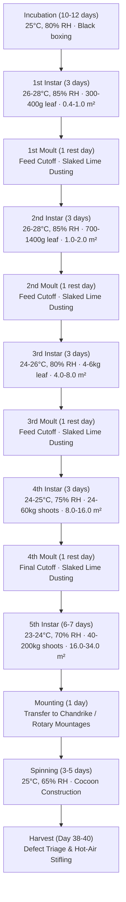
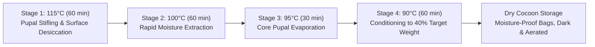
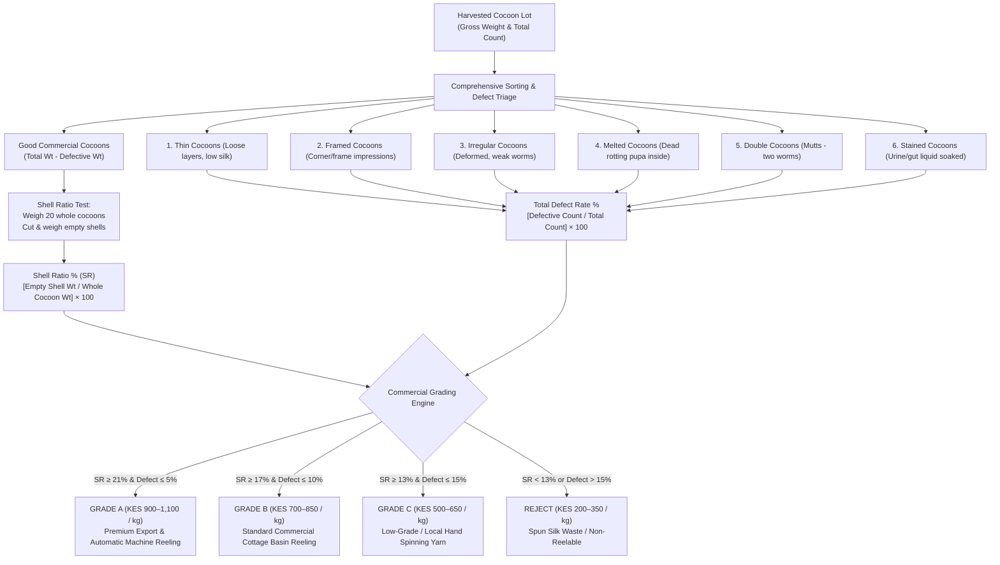
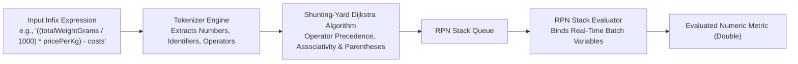

# KALRO Sericulture Farm Management System
## Comprehensive System Architecture, Domain Science & Engineering Overview

---

### Executive Summary

The **KALRO Sericulture Management System** is a mission-critical, offline-first mobile and web application suite engineered for silkworm rearers, station agronomists, research scientists, and extension officers across Kenya. Developed in direct alignment with the **Kenya Agricultural and Livestock Research Organization (KALRO)** and the **National Sericulture Research Centre (NSRC)**, the platform digitizes and optimizes the entire sericulture value chain—from germplasm conservation and breeding pedigree tracking to 5-instar feeding schedules, disease biosecurity, 4-stage automated hot-air cocoon drying, commercial reeling analytics, and mobile farmer payouts.

Sericulture in East Africa operates under distinct environmental, agronomic, and socio-economic conditions:
* Rearing huts and station sheds are frequently situated in rural counties (e.g., Murang'a, Machakos, Kitui, Kirinyaga, Embu, Kakamega, Bungoma) with intermittent or absent cellular networks.
* Farmers handle delicate caterpillars (*Bombyx mori* and *Philosamia ricini* / Eri), fresh damp foliage, and bed disinfectants, demanding hands-free, sunlight-calibrated, high-contrast interfaces.
* Rural farmers predominantly utilize entry-level Android smartphones or feature phones, while station agronomists utilize desktop browsers and tablets for research trials.
* Quality standards require rigorous cocoon sorting, strict elimination of sun-drying practices to preserve sericin and fibroin integrity, and transparent grading to ensure fair farmer compensation via mobile money.

To address these requirements, this platform combines:
1. **Kenyan Germplasm & Genebank Registry**: Characterization of 11 mulberry varieties, 7 castor varieties, 98 accessions across evaluation blocks (C2–C4, D1–D4), Highway Farm, and research genebanks.
2. **Breeding Pedigree & Heterosis Modeling**: Genetic voltinism tracking, parent cross combinations (KSK, ATK, ICIPE, Kinshoshowa), and heterosis vigor calculations.
3. **5-Instar Lifecycle & Bed Space Management**: Mathematical feeding tables, environmental threshold surveillance, and slaked lime powder disinfection ($50\text{--}100\,\text{g/m}^2$) during moult rests.
4. **Automated 4-Stage Hot-Air Cocoon Drying**: Replaces harmful sun-drying with a staged temperature curve ($115^\circ\text{C}\to 100^\circ\text{C}\to 95^\circ\text{C}\to 90^\circ\text{C}$) to guarantee optimal reelability and $40\%$ dry cocoon weight.
5. **Commercial Cocoon Reeling & Quality Grading**: Real-time evaluation of Shell Ratio %, Renditta, Reelability %, Defect Rate %, and automated KALRO Grade A/B/C/Reject classification.
6. **Pathology & Biosecurity Triage**: Diagnostic checklists and biocontrol measures for Grasserie, Pebrine, Flacherie, and Muscardine.
7. **Rural Financial Settlement**: M-PESA B2C payout engine and an offline USSD dialer simulator (`*384*254#`) in English, Kiswahili, and Kikuyu.
8. **Dual-Platform Architecture**: Native Flutter (Dart 3.x) with offline SQLite (`FarmStore`) and React 19 + TypeScript web PWA with monochromatic high-contrast styling adhering to Google Chrome Modern Web Guidance standards.

---

## 1. System Architecture & Dual-Platform Design

The platform consists of two interoperable clients sharing identical domain rules, mathematical models, and data interchange formats:
* **Mobile Client**: Native Flutter (Dart 3.11+ / Flutter 3.27+) targeted at Android, Linux, and Windows, featuring zero-cloud offline persistence, biometric/PIN access control, and hardware integration (QR code scanning, offline TTS audio).
* **Web Client**: Progressive Web Application (React 19 + TypeScript + Vite) targeted at research station workstations, desktop browsers, and tablets, featuring multi-tenant IndexedDB storage, high-contrast monochrome UI, and Google Chrome Modern Web Guidance compliance.

```mermaid
flowchart TD
    subgraph UI_Layer ["Dual Presentation Layer"]
        MobileApp["Flutter Native Mobile App (Android / Linux / Windows)\nOffline SQLite, Biometric / PIN Lock, Bilingual TTS, QR Scanner"]
        WebApp["React 19 Web Dashboard (Vite PWA)\nMonochromatic High-Contrast, Google Chrome Modern Web Guidance"]
    end

    subgraph Domain_Layer ["Sericultural Domain & Calculation Engines"]
        AgronomyEngine["Kenyan Germplasm Registry\n(11 Mulberry, 7 Castor, 98 Accessions, Genebanks)"]
        BreedingEngine["Breeding Pedigree & Heterosis Tracker\n(KSK, ATK, ICIPE, Kinshoshowa, Eri)"]
        LifecycleEngine["5-Instar Biological Lifecycle Engine\n(Feeding Tables, Bed Expansion, Lime Calc)"]
        DryingEngine["4-Stage Hot-Air Drying Controller\n(115°C -> 100°C -> 95°C -> 90°C Curve)"]
        GradingEngine["Cocoon Defect Triage & Grading\n(Shell %, Renditta, Reelability, Pricing)"]
        DiseaseEngine["Biosecurity & Pathology Triage\n(Grasserie, Pebrine, Flacherie, Muscardine)"]
        PayoutEngine["Rural Settlement Engines\n(M-PESA B2C & Offline *384*254# USSD)"]
        FormulaEngine["Mathematical Shunting-Yard Formula Parser\n(Custom Metric RPN Evaluator)"]
    end

    subgraph Data_Layer ["Data Persistence & Interoperability"]
        SQLite["FarmStore (Transactional SQLite with Indexed JSON)"]
        IndexedDB["Multi-Tenant Web Storage (IndexedDB + LocalStorage)"]
        Excel["Multi-Sheet Excel Export (6 Sheets .xlsx)"]
        PDF["Vector PDF Reports (jspdf / pdf)"]
        Backup["Cryptographic JSON Backup & Restore (SHA-256)"]
    end

    MobileApp --> AgronomyEngine
    MobileApp --> BreedingEngine
    MobileApp --> LifecycleEngine
    MobileApp --> DryingEngine
    MobileApp --> GradingEngine
    MobileApp --> DiseaseEngine
    MobileApp --> PayoutEngine
    MobileApp --> FormulaEngine
    MobileApp --> SQLite
    MobileApp --> Excel
    MobileApp --> Backup

    WebApp --> AgronomyEngine
    WebApp --> BreedingEngine
    WebApp --> LifecycleEngine
    WebApp --> DryingEngine
    WebApp --> GradingEngine
    WebApp --> DiseaseEngine
    WebApp --> PayoutEngine
    WebApp --> FormulaEngine
    WebApp --> IndexedDB
    WebApp --> PDF
    WebApp --> Backup
```



### Technology Matrix

| Component | Flutter Mobile Application | React Web PWA | Operational Responsibility |
|---|---|---|---|
| **Core Framework** | Flutter 3.27+ / Dart 3.11+ | React 19.3+ / TypeScript 5.9+ | Application lifecycle, reactive rendering, state management |
| **Styling & Theming** | Material 3 Sunlight-Readable Palette | Monochromatic High-Contrast (Black & White) | Sunlight legibility, WCAG AAA compliance, zero eye strain |
| **Modern Web Standards** | N/A (Native Canvas / Skia) | Google Chrome Modern Web Guidance | `color-scheme`, `light-dark()`, `scrollbar-color`, `text-wrap`, `content-visibility` |
| **Local Persistence** | `sqlite3` + `sqlite3_flutter_libs` | `IndexedDB` (`IDBDatabase`) + `localStorage` | 100% offline-first transactional storage |
| **Data Interchange** | `excel: ^4.0.6` (6-sheet `.xlsx`) | Structured CSV, JSON Backup, PDF Export | Auditing, station report generation, backup serialization |
| **Hardware & Sensors** | `qr_flutter`, `camera`, `flutter_tts` | `qrcode.react`, Web Speech Synthesis | Batch tray QR tracking, hands-free voice guidance |
| **Financial & USSD** | M-PESA B2C validation & USSD dialer | Payout ledger & USSD architectural simulator | Mobile money disbursements and basic phone access |
| **Quality Assurance** | 113 Automated Unit & Widget Tests | Oxlint + TypeScript type check + Vite build | Zero-regression quality assurance |

---

## 2. Characterized Kenyan Germplasm & Genebank Registry

Optimal silkworm health and silk yields depend directly on the nutritional quality, leaf moisture, and succulence of the host plant foliage. The platform embeds the complete official germplasm database established by KALRO / NSRC.

### 2.1 Characterized Mulberry Varieties (*Morus* spp.)

Eleven specialized mulberry cultivars characterized at KALRO Thika are maintained in the system with their agronomic traits and rearing suitabilities:

| Variety Name | Origin / Classification | Leaf Yield (ton/ha/yr) | Leaf Moisture % | Rooting % | Rearing Suitability | Key Agronomic Characteristics |
|---|---|---|---|---|---|---|
| **V1** | High-Yield Bivoltine | 45–55 | 78–82% | 85–90% | Chawki (1st–2nd) & Late Age | Thick, succulent, dark green ovate leaves. High protein retention; standard for bivoltine rearing. |
| **Thika** | Kenyan Selection (Local) | 30–38 | 72–75% | 75–80% | Late Age (3rd–5th Instar) | Highly adapted to Central Kenya mid-altitudes; robust drought tolerance and rapid regrowth. |
| **Embu** | Kenyan Selection (Local) | 32–40 | 73–76% | 78–82% | 2nd to 5th Instar | High palatability; performs well in acidic to neutral volcanic soils. |
| **Ithaanga** | Kenyan Semi-Arid Selection | 28–34 | 70–74% | 70–75% | Late Age Rearing | Superior resistance to prolonged moisture stress; deep taproot system for semi-arid zones. |
| **Limuru** | High-Altitude Kenyan Selection | 26–32 | 74–77% | 65–70% | Mid to Late Age | Frost tolerant; adapted to cold high-altitude conditions (2,000+ m ASL). |
| **Thailand** | Introduced Hybrid | 38–46 | 76–80% | 80–85% | 1st to 5th Instar | Broad, thin leaves with high moisture retention; rapid shoot development under irrigation. |
| **Ichinose** | Japanese Temperate Selection | 30–35 | 75–78% | 60–65% | Chawki Rearing | High crude protein content; ideal for young chawki worms; requires careful pruning. |
| **Kanva 2** | Indian Selection | 35–42 | 74–77% | 80–85% | Late Age Rearing | Vigorous growth habit, highly responsive to farmyard manure and chemical fertilization. |
| **S54** | Improved Triploid Cultivar | 40–48 | 77–81% | 75–80% | Chawki & Early Instars | Large, smooth, lustrous leaves; excellent nutrient conversion ratio. |
| **S36** | Improved Diploid Cultivar | 38–45 | 76–80% | 80–85% | Chawki Rearing | Glossy, high moisture content; delays wilting on the rearing bed. |
| **Unknown 2** | Station Accession (Research) | 28–35 | 72–75% | 70–75% | Evaluation Trials | Ongoing comparative performance and biochemical profiling accession. |

### 2.2 Evaluated Castor Varieties (*Ricinus communis*)

Castor is the mandatory primary host plant for Eri silkworms (*Samia cynthia ricini* / *Philosamia ricini*). The platform incorporates 7 evaluated varieties:
* **Nuu 70**: High leaf biomass cultivar adapted to semi-arid Eastern Kenya (Kitui/Machakos); low ricin toxin expression in mature leaves.
* **KC6**: Fast-maturing dwarf variety suitable for intercropping with food legumes.
* **KC14**: Broad-leaved selection with high moisture retention and resistance to castor rust (*Melampsora ricini*).
* **KC2**: Traditional hardy accession with continuous leaf flush throughout dry periods.
* **KC24**: Heavy canopy producer optimized for dedicated block planting.
* **KC15**: Resistant to leaf hopper infestation; high crude fiber-to-protein ratio suitable for 5th instar larvae.
* **KMC8**: Commercial oilseed and sericulture dual-purpose variety.

### 2.3 Station Genebanks & Field Research Blocks

The platform tracks and records germplasm inventory across designated KALRO research blocks:
* **Genebank Collections**:
  * *Old Genebank*: Historic foundation collection preserving baseline genetic diversity.
  * *New Genebank*: Modern replicated plots for ongoing morphological and molecular characterization.
  * *Centre Genebank*: Repository for elite regional selections (*Ex-Embu, Ex-Thika, Ex-Limuru, Ex-Ithanga*).
* **Evaluation Blocks**:
  * *Blocks C2, C3, and C4*: Replicated agronomic trials assessing pruning response, leaf yield per bush, and spacing densities.
  * *Blocks D1, D2, D3, and D4*: Screened trials evaluating 98 individual accessions for pest resistance, rooting efficiency, and drought recovery.
* **Highway Farm Trials**:
  * Specialized research sectors comprising wild collections, irrigated high-density selections, rainfed/non-irrigated dryland plots, cross selections, and stabilized line selections.

---

## 3. Silkworm Breeding, Pedigree & Heterosis Modeling

The breeding management system records genetic lineage, parental voltinism, and cross performance for both *Bombyx mori* and *Philosamia ricini*.

### 3.1 Silkworm Strains

1. **KSK (Kenya Sericulture Kakamega)**: High-vigor bivoltine strain adapted to tropical mid-elevations. Produces clean, white, peanut-shaped cocoons with high shell content.
2. **ATK (Agricultural Technical Kakamega)**: Robust parental line characterized by high disease tolerance and uniform larval growth.
3. **ICIPE Crosses**: Strains bred for resilience in arid and semi-arid lands (ASAL), demonstrating high tolerance to ambient temperature fluctuations.
4. **Kinshoshowa**: Elite bivoltine hybrid imported and stabilized for maximum commercial filament length ($> 1,200\,\text{m}$) and low Renditta ($< 7.0$).
5. **Eri Silkworm (*Philosamia ricini*)**: Polyvoltine saturniid moth feeding on castor. Produces open-ended, non-reelable spun silk (Ahimsa silk) where moths emerge naturally without destroying filament utility.

### 3.2 Heterosis & Vigor Modeling

The system calculates hybrid vigor ($H\%$) when crossing inbred parental lines to produce $F_1$ commercial eggs:

$$\text{Mid-Parent Value (MP)} = \frac{P_1 + P_2}{2}$$

$$\text{Heterosis Percentage } (H\%) = \left( \frac{F_1 - \text{MP}}{\text{MP}} \right) \times 100$$

Where:
* $P_1$ = Trait value of female parent (e.g., cocoon weight in grams).
* $P_2$ = Trait value of male parent.
* $F_1$ = Observed trait value of the resulting commercial hybrid generation.

*Commercial hybrids exhibit positive heterosis ($+15\%$ to $+35\%$) in single cocoon weight, shell ratio, and effective rearing rate ($ERR\%$).*

---

## 4. Standardized 5-Instar Lifecycle & Bed Space Protocol

The application models the metamorphosis of *Bombyx mori* through 5 distinct larval instars and 4 dormant moults based on standard rearing packages for **20,000 larvae** (one standard 12.5g disease-free egg box).



### 4.1 Instar Feeding & Environmental Schedule

| Stage | Duration | Target Temp (°C) | Target RH (%) | Daily Leaf Rations (20,000 Larvae) | Bed Space Requirement | Leaf Cut & Feed Type |
|---|---|---|---|---|---|---|
| **Egg Incubation** | 10–12 days | $25^\circ\text{C}$ | 80% | None | Egg sheets in incubator | Black-boxing for synchronous hatching |
| **1st Instar** | 3 days | $26\text{--}28^\circ\text{C}$ | 85% | 300g – 400g daily | $0.4\text{--}1.0\,\text{m}^2$ | Top 3rd–4th leaf, finely chopped ($0.5\,\text{cm}^2$) |
| **1st Moult** | 24 hours | $25\text{--}26^\circ\text{C}$ | 70% | **Zero (Cutoff)** | Maintained | Slaked lime powder dusting ($50\text{--}100\,\text{g/m}^2$) |
| **2nd Instar** | 3 days | $26\text{--}28^\circ\text{C}$ | 85% | 700g – 1,400g daily | $1.0\text{--}2.0\,\text{m}^2$ | Leaves below glossy leaf, chopped ($1.0\text{--}2.0\,\text{cm}^2$) |
| **2nd Moult** | 24 hours | $25\text{--}26^\circ\text{C}$ | 70% | **Zero (Cutoff)** | Maintained | Absolute rest; lime dusting |
| **3rd Instar** | 3 days | $24\text{--}26^\circ\text{C}$ | 80% | 4.0kg – 6.0kg daily | $4.0\text{--}8.0\,\text{m}^2$ | Green-stem leaves, whole or coarse cut |
| **3rd Moult** | 24 hours | $24\text{--}25^\circ\text{C}$ | 70% | **Zero (Cutoff)** | Maintained | Bed cleaning prior to settling; lime dusting |
| **4th Instar** | 3 days | $24\text{--}25^\circ\text{C}$ | 75% | 24.0kg – 60.0kg daily | $8.0\text{--}16.0\,\text{m}^2$ | Whole shoots ($1.0\text{--}1.5\,\text{m}$) or entire branches |
| **4th Moult** | 24–36 hours | $23\text{--}24^\circ\text{C}$ | 70% | **Zero (Cutoff)** | Maintained | Bed cleaning; lime dusting |
| **5th Instar** | 6–7 days | $23\text{--}24^\circ\text{C}$ | 70% | 40.0kg – 200.0kg daily | $16.0\text{--}34.0\,\text{m}^2$ | Peak appetite; fresh whole shoots fed 3–4 times daily |
| **Mounting** | 1 day | $25^\circ\text{C}$ | 65% | None | 20–25 *Chandrikes* | Transfer ripe translucent caterpillars |
| **Spinning** | 3–5 days | $25^\circ\text{C}$ | 60–65% | None | Mountages | Good ventilation to evaporate excreted water |
| **Harvest** | Days 38–40 | Ambient | Ambient | None | Sorting tables | Harvest 6–8 days after mounting starts |

### 4.2 Moult Physiology & Slaked Agricultural Lime Protocol

During larval moulting, caterpillars cease feeding, anchor their abdominal prolegs to the bed surface, and raise their anterior segments. Disturbing worms or feeding during moult causes asynchronous development, damaged head capsules, and digestive failure.

**Slaked Agricultural Lime Powder ($\text{Ca(OH)}_2$) Procedure**:
1. When $90\text{--}95\%$ of larvae settle for moult, cease feeding immediately.
2. Dust the rearing bed with dry slaked agricultural lime powder at a calibrated rate of **$50\text{--}100\,\text{g/m}^2$** using a fine mesh sieve.
3. The alkaline lime absorbs excess moisture, maintains bed dryness ($< 70\%\text{ RH}$), and inactivates airborne polyhedrosis viruses and fungal spores.
4. When all larvae have shed their skins and resume active movement, resume feeding with fresh succulent leaves.

---

## 5. Automated 4-Stage Hot-Air Cocoon Drying

Traditional sun-drying of green cocoons is strictly forbidden in commercial sericulture: solar ultraviolet radiation ($290\text{--}400\,\text{nm}$) degrades fibroin and sericin proteins, induces yellowing, breaks molecular cross-linkages, causes sericin insolubility during boiling, and drastically drops reeling filament continuity.

The platform includes an automated 4-stage hot-air drying controller and countdown system engineered according to NSRC thermal guidelines:



### 5.1 Temperature Curve & Thermal Objectives

1. **Stage 1 ($115^\circ\text{C}$ for 60 minutes)**: Rapid stifling of the living pupae inside the cocoon shell. High heat terminates pupal development instantly before the moth can secrete alkaline proteases that cut silk fibers. Surface moisture is rapidly evaporated.
2. **Stage 2 ($100^\circ\text{C}$ for 60 minutes)**: Sustained evaporation without boiling the inner pupal fluids. Prevents pupal rupture (*melted cocoons*) from staining the inner shell.
3. **Stage 3 ($95^\circ\text{C}$ for 30 minutes)**: Gradual heat conduction into the core of the dried pupa, drawing out residual visceral moisture.
4. **Stage 4 ($90^\circ\text{C}$ for 60 minutes)**: Final conditioning stage bringing the dried cocoon lot to exactly **$38\text{--}42\%$ of its original green weight** (target $40\%$).

$$\text{Target Dry Weight (kg)} = \text{Fresh Green Weight (kg)} \times 0.40$$

### 5.2 Dry Weight Verification

After completing the 210-minute cycle, the operator weighs a representative sample. If the sample exceeds $42\%$ of green weight, an additional 30 minutes at $90^\circ\text{C}$ is triggered. Once stabilized, cocoons can be stored safely in insect-proof, dry conditions for up to 12 months without mold or dermestid beetle damage.

---

## 6. Cocoon Defect Triage, Analytics & Market Valuation

Economic viability hinges on sorting out unreelable cocoons before marketing or basin reeling. The platform embeds an interactive defect classifier and pricing engine.



### 6.1 Commercial Formulas

#### 1. Shell Ratio Percentage ($SR\%$):
$$SR\% = \left( \frac{\text{Empty Shell Weight (g)}}{\text{Total Whole Cocoon Weight (g)}} \right) \times 100$$

#### 2. Commercial Renditta ($R$):
Number of kilograms of fresh green cocoons required to produce 1 kg of raw silk filament:
$$R = \frac{\text{Fresh Cocoon Weight (kg)}}{\text{Raw Silk Yield (kg)}} \quad \text{or} \quad R_{\text{est}} = \text{clamp}\left( \frac{100}{SR\% \times 0.80}, 4.0, 20.0 \right)$$

#### 3. Reelability Index ($RI\%$):
$$RI\% = \left( \frac{\text{Total Cocoons Reeled}}{\text{Total Cocoons Reeled} + \text{Basin Thread Breaks}} \right) \times 100$$

#### 4. Effective Rearing Rate ($ERR\%$):
$$ERR\% = \left( \frac{\text{Harvested Good Cocoons}}{\text{Total Eggs Branded}} \right) \times 100$$

#### 5. Net Lot Valuation Formula:
$$\text{Net Payout (KES)} = (\text{Reelable Weight (kg)} \times \text{Base Price}) \times \left(1 + \frac{SR\% - 18\%}{100}\right) \times \left(1 - \frac{\text{Defect Rate } \%}{100}\right)$$

---

## 7. Silkworm Pathology & Biosecurity Triage

Silkworms are vulnerable to viral, microsporidian, bacterial, and fungal pathogens. The system provides immediate field diagnostic symptoms and containment protocols:

| Disease | Pathogen Type | Primary Visual Symptoms | Urgency & Quarantine Protocol | Corrective Field Action |
|---|---|---|---|---|
| **Grasserie** | Nuclear Polyhedrosis Virus (BmNPV) | Swollen intersegmental membranes, shining translucent skin, restless crawling to bed edges, milky hemolymph leaking from skin ruptures. | **Critical (Quarantine)**: Spreads rapidly through contaminated leaves and bed litter. | Isolate and incinerate diseased larvae. Do not touch healthy beds after handling. Dust slaked lime ($100\,\text{g/m}^2$) + $2\%$ bleaching powder immediately. |
| **Pebrine** | Microsporidia (*Nosema bombycis*) | Microscopic pepper-like black spots on integument, uneven larval growth, sluggish movement, failure to moult. Transovarially transmitted. | **Catastrophic (Total Cull)**: Destroys entire seed generations if uncontained. | Immediately burn affected batch. Formalin fumigation ($2\%$) of rearing room and trays. Mother moth microscopic examination before egg dispatch. |
| **Flacherie** | Bacterial / Infectious Flacherie Virus (BmIFV) | Flaccid body, digestive failure, translucent cephalothorax, dark foul-smelling vomit, liquid excreta, dead worms turning black and rotting. | **High**: Caused by poor ventilation, fermented leaves, or thermal stress ($> 28^\circ\text{C}$). | Remove decaying leaves. Improve cross-ventilation. Dust rearing bed with slaked lime. Reduce feeding density and adjust temperature. |
| **Muscardine** | Fungal (*Beauveria bassiana*) | Limp larvae with oily specks initially; after death, carcass turns stiff and chalky white (covered with white mycelia and conidia). | **High**: Airborne spores germinate directly through cuticle in high humidity ($> 85\%$). | Dust Dithane M-45 ($2\%$) or Captan mixed with slaked lime ($98\%$). Reduce rearing house humidity below $70\%$ using ventilation and fans. |

---

## 8. Rural Financial Settlement & Connectivity Infrastructure

### 8.1 M-PESA B2C Payout Engine

To support immediate, transparent financial settlement when farmers deliver sorted green cocoons to station collection centres, the platform integrates an M-PESA B2C payout calculator conforming to the **Safaricom Daraja API** standard:
* Validates Kenyan MSISDN phone numbers (`2547XXXXXXXX` or `2541XXXXXXXX`).
* Calculates tiered M-PESA B2C disbursement charges and net bank settlements.
* Generates cryptographic payment reference codes (`KALRO-B2C-YYYYMMDD-XXXX`).
* Records payment ledgers offline in `FarmStore` SQLite and IndexedDB, ready for batch synchronization when connectivity resumes.

### 8.2 Interactive Offline USSD Simulator (`*384*254#`)

For farmers in remote regions who do not own smartphones, extension officers and farmers can simulate and navigate the official KALRO Sericulture USSD menu:
* **Service Code**: `*384*254#`
* **Multilingual Menu Tree**: English, Kiswahili, and Kikuyu.
* **Core Functions**:
  * `1`: Check Today's Feed Rations (by instar day).
  * `2`: Report Daily Mortality or Disease Symptoms.
  * `3`: Check Current Cocoon Buying Prices (Grade A/B/C).
  * `4`: Request Extension Officer Visit or Grainage Egg Delivery.
  * `5`: Query M-PESA Payout Status.

---

## 9. Mathematical Formula Engine

The platform features an on-device mathematical parser and evaluator (`lib/services/formula_engine.dart`) using **Edsger Dijkstra's Shunting-Yard Algorithm** to parse infix mathematical expressions into Reverse Polish Notation (RPN) queues:



### Supported Token Operations:
* **Binary Operators**: Addition (`+`), Subtraction (`-`), Multiplication (`*`), Division (`/`), Exponentiation (`^`).
* **Unary Operators**: Negation (`-x`).
* **Runtime Dynamic Variables**: `totalWeightGrams`, `cocoonCount`, `goodCount`, `defectiveCount`, `eggCount`, `shellWeightGrams`, `pricePerKg`, `totalCosts`, `renditta`.

---

## 10. Data Persistence, Multi-Tenancy & Interoperability

### 10.1 `FarmStore` SQLite Engine (Flutter Mobile)

The Flutter application relies on a zero-dependency, native `sqlite3` transactional engine (`lib/services/farm_store.dart`):
* **ACID Transactions**: Guarantees zero data loss during phone power cuts or battery depletion.
* **Hybrid Schema**: Combines indexed relational columns (`id`, `batch_id`, `created_at`) with schema-free JSON payloads (`data TEXT`) and SQLite generated column extraction (`json_extract(data, '$.recordedAt')`).

### 10.2 Multi-Tenant IndexedDB Engine (React Web)

The React web application utilizes an isolated multi-tenant IndexedDB store (`web_app/src/storage.ts`):
* Accommodates multiple farmer or technician profiles on shared community computers.
* Isolates records for batches, feeding logs, harvests, and financial ledgers per user profile.
* Supports seamless switching between profiles and secure data purging.

### 10.3 Multi-Sheet Excel Engine (`.xlsx`)

The `ExcelExportService` compiles the entire farm or research station history into a standardized 6-sheet spreadsheet:
1. `Batches`: ID, Species, Strain, Egg Count, Start Date, Status, Location, Caretaker.
2. `Feeding_Ledger`: Batch ID, Timestamp, Leaf Type, Grams Fed, Instar Stage, Notes.
3. `Health_Mortality`: Batch ID, Deaths, Cause/Disease, Biosecurity Treatment, Isolation.
4. `Environment`: Temperature (°C), Relative Humidity (%), Ventilation, Natural Light.
5. `Cocoon_Harvest`: Harvest Date, Cocoon Count, Total Weight, Shell Weight, Defect Count, Grade.
6. `Financial_Ledger`: Transaction ID, Direction, Amount KES, Category, Receipt Number.

### 10.4 Cryptographic JSON Backup & Restore

Exports all database collections into a signed JSON file verified with a **SHA-256** checksum. The system detects any payload tampering or bitrot prior to restoration.

---

## 11. Design System & Modern Web Standards

The web application (`web_app/`) adheres strictly to the **Google Chrome Modern Web Guidance** specifications:

1. **Monochromatic High-Contrast Palette**:
   * Pure black (`#000000`) and pure white (`#FFFFFF`) primary colors with neutral grayscale accents (`#FAFAFA`, `#F4F4F5`, `#E4E4E7`, `#27272A`, `#18181B`, `#09090B`).
   * Eliminates low-contrast decorative colors for optimal legibility in direct equatorial sunlight.
2. **`dark-mode` & Modern Color Tokens**:
   * Embedded `<meta name="color-scheme" content="light dark" />`.
   * Root CSS declaration `color-scheme: light dark;`.
   * Dynamic CSS variables powered by standard `light-dark()` functions (e.g., `light-dark(#000000, #FFFFFF)`).
3. **`browser-ui-theming`**:
   * Standard W3C `scrollbar-color: light-dark(#D4D4D8, #3F3F46) transparent;` and `scrollbar-width: thin;`.
   * High-contrast `::selection` theming for crisp text readability.
4. **`improve-text-layout-and-legibility`**:
   * `text-wrap: balance;` applied across all section titles, cards, and modal headings.
   * `text-wrap: pretty;` on instructional body copy and biosecurity guides to prevent typographically jarring orphan words.
5. **`soft-edge-content-fade`**:
   * Horizontal scroll containers (e.g., navigation tabs, table headers) utilize CSS `mask-image` linear gradients to provide clear visual affordance when items overflow.
6. **`defer-rendering-heavy-content`**:
   * Below-the-fold cards and complex diagnostic trees employ `content-visibility: auto;` paired with `contain-intrinsic-size: auto none auto 240px;` to optimize layout rendering and scroll responsiveness.
7. **`required-field-feedback`**:
   * Form inputs apply `:user-invalid` and `:required:user-valid` pseudo-classes to avoid displaying aggressive red validation borders before the user has touched the field.

---

## 12. Comprehensive Codebase Directory Map

```text
c:\Users\Ian\Documents\Apps\Kalro-App\
├── lib/                                        # Native Flutter Cross-Platform Application
│   ├── components/                             # Granular, Reusable UI Components
│   │   ├── batch/                              # Batch list cards, tray QR dialogs, edit forms
│   │   ├── buttons/                            # KalroPrimaryButton, high-contrast action buttons
│   │   ├── cards/                              # Leaf depletion, KPI metrics, climate summary cards
│   │   ├── dashboard/                          # Farm work overview, alerts banners
│   │   ├── feeding/                            # Feeding log dialogs, gram inputs, skipped feed forms
│   │   ├── harvest/                            # Cocoon sorting, defect counters, grading pills
│   │   ├── health/                             # Mortality records, disease symptom selection
│   │   ├── layout/                             # KalroToolbar, backgrounds, sunlight headers
│   │   ├── lifecycle/                          # TodayBatchWorkCard, floor actions, milestone strips
│   │   ├── navigation/                         # FarmerBottomBar, responsive shell routing
│   │   └── profile/                            # ProfileHeader, farm settings, credential tiles
│   ├── constants/                              # System colors, typography tokens, sericulture thresholds
│   ├── l10n/                                   # Localization resources (English & Kiswahili ARB catalogs)
│   ├── models/                                 # Immutable Domain Data Models
│   │   ├── batch.dart                          # Batch entity, species, strain, stage, location
│   │   ├── cocoon_harvest.dart                 # Cocoon lot, weight, defects, reeling samples
│   │   ├── cocoon_metrics.dart                 # Renditta, shell ratio, grade, survival rate
│   │   ├── feed_log.dart                       # Feeding event, leaf grams, feeding stage, skipped flag
│   │   ├── mortality_log.dart                  # Daily deaths, disease classification, isolation status
│   │   ├── environment_log.dart                # Rearing house temperature (°C), RH%, ventilation
│   │   ├── leaf_inventory.dart                 # Stock weights for Mulberry, Castor, Kesseru
│   │   ├── payment_record.dart                 # Farm expenses, leaf purchases, cocoon sales
│   │   └── species.dart                        # Species enum (Bombyx mori vs. Samia cynthia ricini)
│   ├── screens/                                # Primary Application Views
│   │   ├── rearing_hub_screen.dart             # "Today" routine dashboard (zero dummy data)
│   │   ├── batches_screen.dart                 # Active & historical batches list
│   │   ├── create_batch_screen.dart            # Streamlined batch registration
│   │   ├── batch_detail_screen.dart            # Individual batch lifecycle, feed history, QR tag
│   │   ├── lifecycle_planner_screen.dart       # Interactive calendar of expected milestones
│   │   ├── feeding_screen.dart                 # Feeding logs history & quick log action
│   │   ├── health_screen.dart                  # Mortality records & environmental climate logs
│   │   ├── harvest_screen.dart                 # Cocoon sorting, defect classification & grading
│   │   ├── inventory_screen.dart               # Leaf stock depletion & runout forecaster
│   │   ├── finance_screen.dart                 # Financial ledger & cocoon sales receipts
│   │   ├── reports_screen.dart                 # Report exports (Excel .xlsx, PDF, CSV)
│   │   ├── farmer_profile_screen.dart          # Minimalist farmer settings, PIN, profile deletion
│   │   ├── field_guide_screen.dart             # Offline sericulture rearing manual & disease guide
│   │   ├── bed_space_lime_screen.dart          # Bed space expansion & slaked lime calculator
│   │   ├── breeding_pedigree_screen.dart       # Silkworm strain breeding & heterosis tracking
│   │   ├── cocoon_grading_screen.dart          # Cocoon defect sorting & pricing
│   │   ├── disease_triage_screen.dart          # Biosecurity symptom triage & containment
│   │   ├── hot_air_drying_screen.dart          # 4-stage hot-air drying controller
│   │   ├── mpesa_payout_screen.dart            # M-PESA B2C farmer payout engine
│   │   └── ussd_dialer_screen.dart             # Offline *384*254# USSD simulator
│   ├── services/                               # Business Logic & Infrastructure Repositories
│   │   ├── farm_store.dart                     # SQLite transactional persistence engine
│   │   ├── lifecycle_engine.dart               # Instar timeline predictor with climate adjustments
│   │   ├── lifecycle_profiles.dart             # Stage definitions for Bombyx and Eri
│   │   ├── rearing_day_service.dart            # Today's stage, feed rations, moult detection
│   │   ├── cocoon_analytics_service.dart       # Renditta, shell %, defect rate & commercial grading
│   │   ├── formula_engine.dart                 # Shunting-yard RPN custom formula parser
│   │   ├── leaf_ledger_service.dart            # 14-day leaf consumption & depletion forecaster
│   │   ├── audio_guidance_service.dart         # Hands-free bilingual TTS voice synthesizer
│   │   ├── excel_export_service.dart           # 6-sheet .xlsx Excel generator
│   │   ├── backup_service.dart                 # SHA-256 verified JSON database backup & restore
│   │   └── sensor_manager_service.dart         # Environmental BLE & manual microclimate sync
│   └── theme/                                  # KALRO sunlight-readable theme definitions
│
├── web_app/                                    # React 19 + TypeScript Progressive Web App
│   ├── src/
│   │   ├── components/                         # Modular Web Views
│   │   │   ├── TodayView.tsx                   # Minimalist routine cards, quick log modals
│   │   │   ├── BatchesView.tsx                 # Batch list, status pills, QR dialog triggers
│   │   │   ├── PlanView.tsx                    # Visual lifecycle timeline & stage progress
│   │   │   ├── FarmToolsView.tsx               # Leaf ledger, mortality, climate & cocoon analytics
│   │   │   ├── StationAgronomyView.tsx         # 5-tab Station Agronomy & Germplasm Hub
│   │   │   ├── AuditDashboardView.tsx          # Traceability, quality control & audit reports
│   │   │   ├── ProfileView.tsx                 # Multi-tenant profile management & deletion
│   │   │   ├── QuickLogModal.tsx               # Flexible whole-number feed & climate logging
│   │   │   ├── QrCodeModal.tsx                 # Printable tray QR code generator
│   │   │   ├── DryingTimerModal.tsx            # 4-stage hot-air drying interactive timer
│   │   │   └── Header.tsx                      # Modern navigation header with monochrome theme
│   │   ├── constants.ts                        # Germplasm registry, feeding tables, user roles
│   │   ├── storage.ts                          # Multi-tenant IndexedDB & LocalStorage engine
│   │   ├── types.ts                            # TypeScript domain model definitions
│   │   ├── translations.ts                     # Bilingual EN/SW web dictionaries
│   │   ├── utils/                              # PDF generators, RPN formula parser, math helpers
│   │   └── index.css                           # Monochromatic Modern Web Guidance CSS
│   ├── index.html                              # PWA shell with color-scheme metadata
│   ├── package.json                            # Web dependencies and build scripts
│   └── vite.config.ts                          # Vite bundler configuration
│
├── test/                                       # Automated Quality Assurance Suite (113 Tests)
│   ├── lifecycle_engine_test.dart              # Stage durations, Bombyx day 40 harvest, Eri day 39
│   ├── cocoon_analytics_service_test.dart      # Renditta math, shell ratio, Grade A/B/C validation
│   ├── formula_engine_test.dart                # Infix tokenization, RPN shunting-yard, precedence
│   ├── excel_export_service_test.dart          # Multi-sheet .xlsx structure verification
│   ├── farm_store_test.dart                    # SQLite transactional read/write & json_extract
│   ├── rearing_day_service_test.dart           # Feed scaling, moult rest alerts, skipped feeds
│   ├── backup_service_test.dart                # Backup serialization, restore & checksum defense
│   ├── widget_test.dart                        # Main UI smoke tests, onboarding, navigation
│   └── feature_smoke_test.dart                 # Full feature interaction & screen rendering tests
│
├── OVERVIEW.md                                 # Comprehensive Architectural & Agronomic Specification
├── README.md                                   # Quickstart, Features & Registry Summary
└── pubspec.yaml                                # Flutter package configuration & dependencies
```

---

## 13. Operational Guidelines for Rural Deployment & Station Management

1. **Sunlight Legibility & Contrast**:
   Both Flutter and React clients adhere strictly to high-contrast monochrome design guidelines. Even in bright outdoor sunlight or dark mud-walled rearing sheds, critical figures (temperatures, feed weights, moult alerts) remain instantly readable.
2. **Autonomous Offline Execution**:
   The platform never halts due to lack of network connection. All data entry, calculations, and local exports function seamlessly without network requests.
3. **Hardware Compatibility & Battery Optimization**:
   The Flutter application targets devices starting from Android 8.0 (API 26) with minimal memory footprint (< 90 MB RAM), preventing app freezes on low-cost devices.
4. **Data Portability for Extension Services**:
   When agricultural extension agents or research scientists visit rural farms, data can be transferred via QR code scanning or exported to an unencrypted 6-sheet `.xlsx` workbook on an SD card or USB drive.

---
*Developed for the Kenya Agricultural and Livestock Research Organization (KALRO) and the National Sericulture Research Centre (NSRC).*
