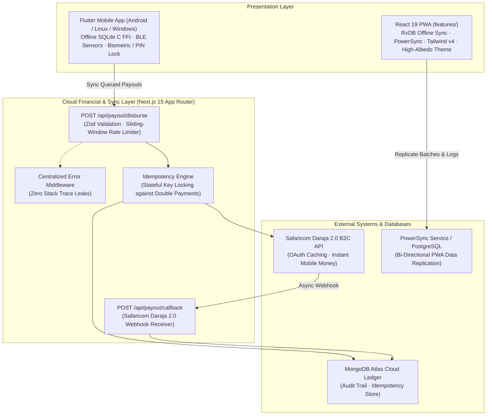

# KALRO Sericulture Farm Management & Research Operating System

[](https://flutter.dev)
[](https://dart.dev)
[](https://react.dev)
[](https://www.typescriptlang.org)
[](https://nextjs.org)
[](https://tailwindcss.com)
[](https://opensource.org/licenses/MIT)
[](#)

**KALRO Sericulture** is a mission-critical, production-grade operating system and research platform engineered for Kenyan silkworm farmers, station agronomists, research scientists, and extension officers. Developed in direct alignment with the **Kenya Agricultural and Livestock Research Organization (KALRO)** and the **National Sericulture Research Centre (NSRC)** in Thika, the platform digitizes the entire sericulture value chain—from germplasm conservation and egg incubation to 5-instar feeding schedules, disease biosecurity, automated 4-stage hot-air cocoon drying, commercial reeling analytics, and mobile farmer payouts.

---

## Tri-Part System Architecture

The platform is built on an enterprise tri-part architecture designed for resilient rural operation:

1. **Native Flutter Mobile Client (`lib/`)**:
   * Cross-platform (Android, Linux, Windows) with zero-cloud offline persistence.
   * High-performance on-device SQLite via C FFI (`FarmStore`) featuring dedicated B-tree indexes on `batch_id`, `created_at`, and the generated column for `stage`.
   * High-frequency BLE sensor logging (temperature & relative humidity every 15 minutes) using atomic SQLite transactions for bulk writes to prevent disk I/O bottlenecks.
   * Complete cursor lifecycle management with clean `dispose()` methods preventing memory leaks.
   * Bilingual English and Kiswahili localization with offline Text-to-Speech (TTS) voice guidance.

2. **React 19 Progressive Web Application (`web_app/`)**:
   * High-albedo institutional SaaS aesthetic with a clean white canvas (`#FFFFFF`), Mulberry Green (`#16A34A`), and Raw Silk Gold (`#D97706`) accents, meeting strict WCAG AAA contrast ratios.
   * Modular `bulletproof-react` feature-based architecture (`features/batches`, `features/agronomy`, `features/finance`, `features/health`) with isolated domain types, hooks, and components.
   * Offline-first synchronization engine built with **RxDB** (`lib/rxdb/`) on top of Dexie (IndexedDB) with **PowerSync** PostgreSQL replication for live central syncing.
   * Tailwind CSS v4 compilation via `@tailwindcss/vite` powering the 8-subtab Station Agronomy Hub.
   * Unified Executive Operations Command Card in `TodayView` consolidating rearing operations, shift guidance, next ration countdowns, and rotating staff duty assignments.

3. **Cloud Financial Disbursement API (`backend_api/`)**:
   * Next.js 15 App Router serverless backend managing Safaricom Daraja M-PESA B2C cocoon harvest disbursements.
   * Built according to **Node Best Practices**:
     * **Strict Secrets Guard**: Boot-up environment validation via Zod; halts compilation immediately if `DARAJA_CONSUMER_KEY`, `DARAJA_CONSUMER_SECRET`, or `MONGODB_URI` are missing or malformed.
     * **Centralized Error Handling**: Standardized error envelope concealing system stack traces and file paths in production.
     * **Strict Payload Sanitization**: Zod validation schemas for `POST /api/payout/disburse` sanitizing all inputs before reaching Safaricom APIs.
     * **Sliding-Window Rate Limiting**: In-memory sliding-window protection against burst requests and API abuse.
     * **Idempotency Key Engine**: Guarantees that rural network retries from farmer devices never result in duplicate financial payouts.

---

## Architecture Diagram



---

## Domain Science & Kenyan Sericulture Registry

The platform incorporates verified agronomic and biological protocols from *"A Manual Guide for Sericulture in Kenya"* (KALRO / NSRC):

### 1. Characterized Germplasm & Genebank Registry
* **Characterized Mulberry Varieties (11 Cultivars)**: V1, Thika, Embu, Ithaanga, Limuru, Thailand, Ichinose, Kanva 2, S54, S36, and Unknown 2.
* **Evaluated Castor Varieties (7 Varieties)**: Nuu 70, KC6, KC14, KC2, KC24, KC15, and KMC8 (essential host plants for non-mulberry Eri silkworm production).
* **Station Genebank & Research Blocks**:
  * **Genebanks**: Old Genebank, New Genebank, and Centre Genebank holding *Ex-Embu, Ex-Thika, Ex-Limuru, and Ex-Ithanga*.
  * **Evaluation Blocks**: Blocks C2, C3, C4 and D1, D2, D3, D4 evaluating 98 accessions.
  * **Highway Farm**: Collections, irrigated selections, non-irrigated plots, cross selections, and line selections.

### 2. Silkworm Strains & Breeding Tracking
* **Bombyx mori (Mulberry Silkworm)**: KSK, ATK, ICIPE, and Kinshoshowa (pure parental strains and high-vigor bivoltine/multivoltine cross-hybrids).
* **Eri Silkworm (*Samia cynthia ricini* / *Philosamia ricini*)**: Polyphagous castor/kesseru feeder spinning open-ended cocoons harvested without killing the pupae.
* **Pedigree & Heterosis Tracker**: Monitors parental voltinism, cocoon yield, and heterosis vigor percentages ($H\%$).

### 3. Standardized 5-Instar Feeding & Bed Space Protocol
Prescribed schedules for a standard rearing box (20,000 larvae):
* **1st Instar** ($26\text{--}28^\circ\text{C}, 85\%\text{ RH}$): 300g–400g daily tender chopped leaves (top 3rd–4th leaf, $0.5\,\text{cm}^2$). Bed space $0.4\text{--}1.0\,\text{m}^2$.
* **2nd Instar** ($26\text{--}28^\circ\text{C}, 85\%\text{ RH}$): 700g–1,400g daily chopped leaves below glossy leaf. Bed space $1.0\text{--}2.0\,\text{m}^2$.
* **3rd Instar** ($24\text{--}26^\circ\text{C}, 80\%\text{ RH}$): 4kg–6kg daily green-stem leaves. Bed space $4.0\text{--}8.0\,\text{m}^2$.
* **4th Instar** ($24\text{--}25^\circ\text{C}, 75\%\text{ RH}$): 24kg–60kg whole shoots ($1.0\text{--}1.5\,\text{m}$). Bed space $8.0\text{--}16.0\,\text{m}^2$.
* **5th Instar** ($23\text{--}24^\circ\text{C}, 70\%\text{ RH}$): 40kg–200kg peak shoot feeding. Bed space $16.0\text{--}34.0\,\text{m}^2$.
* **Moulting & Bed Hygiene**: Complete feed stoppage during skin shedding; slaked agricultural lime powder dusting ($50\text{--}100\,\text{g/m}^2$) to reduce humidity and manage viral infections.

### 4. 4-Stage Automated Hot-Air Cocoon Drying
Strictly replaces traditional sun drying (which causes ultraviolet degradation, cocoon yellowing, and sericin denaturation):
* **Stage 1**: $115^\circ\text{C}$ for 60 min — pupae stifle and rapid surface desiccation.
* **Stage 2**: $100^\circ\text{C}$ for 60 min — controlled moisture release.
* **Stage 3**: $95^\circ\text{C}$ for 30 min — core pupal desiccation.
* **Stage 4**: $90^\circ\text{C}$ for 60 min — final conditioning to reach the target $40\%$ dry cocoon weight.

### 5. Cocoon Defect Triage & Market Grading
* **Defect Categories**: Thin cocoons (loose layers, low silk), Framed cocoons (frame imprints), Irregular cocoons (abnormal shape from weak larvae), Melted cocoons (pupal death and inner staining), Double cocoons (two worms spinning together), and Stained cocoons (urine/gut fluid absorption).
* **Quality Valuation**: Automatic grading into **Grade A**, **Grade B**, **Grade C**, or **Reject** based on shell ratio percentage and defect rate thresholds.

### 6. Disease Biosecurity Triage
* Differential symptom checklists and emergency biocontrol procedures for:
  * **Grasserie (Nuclear Polyhedrosis Virus)**: Milky hemolymph, shiny skin, restlessness.
  * **Pebrine (Microsporidia - *Nosema bombycis*)**: Pepper-like black spots, irregular moulting.
  * **Flacherie (Bacterial/Viral Infectious Flacherie)**: Transparent thorax, digestive liquefaction.
  * **Muscardine (Fungal - *Beauveria bassiana*)**: White chalky efflorescence, body stiffness.

---

## Core Feature Comparison

| Capability | Flutter Mobile App (`lib/`) | React Web PWA (`web_app/`) | Backend API (`backend_api/`) |
|---|---|---|---|
| **Primary Platform** | Android, Linux, Windows | Desktop browsers, Tablets, Chrome PWA | Next.js 15 Serverless (Node.js runtime) |
| **Architecture** | Service-Repository Pattern | Bulletproof Feature Modules (`features/`) | Modular Clean Controller / Service Route Handlers |
| **Local Persistence** | SQLite via C FFI with B-Tree Indexes | RxDB (Dexie IndexedDB) + PowerSync | Stateless / MongoDB Atlas Connection Pool |
| **Offline Synchronization** | Local file backup / CSV / Excel export | Real-time PowerSync PostgreSQL Sync | REST endpoints for queued sync ingestion |
| **Styling & Theme** | Material 3 Sunlight-Readable Palette | Executive High-Albedo Institutional SaaS | Structured JSON API responses |
| **Agronomy & Genebanks** | Interactive calculators & lookup screens | 8-Subtab Station Agronomy Hub (Tailwind v4) | N/A |
| **Cocoon Drying & Grading** | 4-stage countdown timer & defect tally | Real-time drying SOP & defect classifier | Cocoon delivery procurement ledger |
| **Farmer Financials** | Offline M-PESA calculation & sync queue | Station financial ledger & balance audit | Safaricom Daraja B2C execution & idempotency |
| **USSD Support** | Interactive offline dialer (`*384#`) | Web-based feature phone USSD simulator | Webhook endpoint ready for Africa's Talking |
| **Hardware & Sensors** | BLE sensor sync (15-min atomic batches) | Chamber microclimate log viewer | Station telemetry ingestion |

---

## Documentation Hub

Comprehensive, multi-tier engineering and agronomic manuals are centralized in the [`docs/`](./docs/) directory:

* **[Master Project Documentation (`docs/PROJECT_MASTER_DOCUMENTATION.md`)](./docs/PROJECT_MASTER_DOCUMENTATION.md)**: Exhaustive 18-section technical manual covering institutional context, tri-part architecture, germplasm registry, 5-instar feeding schedules, 4-stage hot-air drying, defect grading, biosecurity triage, financial settlement, on-device formula engine, SQLite C FFI, RxDB offline sync, Node Best Practices, and deployment.
* **[System Architecture & Agronomy Guide (`docs/OVERVIEW.md`)](./docs/OVERVIEW.md)**: Complete domain, germplasm, and lifecycle specification with biological curves and drying charts.
* **[Web Application Architecture (`docs/web_app.md`)](./docs/web_app.md)**: React 19 PWA, `bulletproof-react` feature modules, RxDB offline sync on Dexie (IndexedDB), PowerSync live PostgreSQL replication, and Tailwind CSS v4.
* **[Cloud Backend API Guide (`docs/backend_api.md`)](./docs/backend_api.md)**: Next.js 15 App Router, Safaricom Daraja 2.0 B2C integration, Zod secrets guard, rate limiting, and idempotency key engine.
* **[Documentation Directory Hub (`docs/README.md`)](./docs/README.md)**: Master index and table of contents for all platform documentation.

---

## Directory Structure

```text
Kalro-App/
├── backend_api/                        # Next.js 15 Cloud Financial Backend
│   ├── app/                            # App Router endpoints
│   │   ├── api/payout/disburse/        # POST disbursement handler with idempotency
│   │   └── api/payout/callback/        # POST Daraja webhook receiver
│   ├── lib/                            # Core backend infrastructure
│   │   ├── daraja.ts                   # Safaricom Daraja 2.0 OAuth & B2C client
│   │   ├── env.ts                      # Strict Zod boot-up secrets validation
│   │   ├── errors.ts                   # Centralized error handler (no stack leaks)
│   │   ├── idempotency.ts              # Idempotency key engine against double payments
│   │   ├── mongodb.ts                  # MongoDB Atlas connection pooling
│   │   └── rate-limiter.ts             # Sliding-window rate limiting
│   └── test_backend.ts                 # Comprehensive security & idempotency test suite
│
├── docs/                               # Centralized Platform Documentation
│   ├── README.md                       # Documentation Index & Roadmap
│   ├── OVERVIEW.md                     # Architectural, Domain & Agronomic Specification
│   ├── PROJECT_MASTER_DOCUMENTATION.md # Complete Technical Reference Manual
│   ├── web_app.md                      # React 19 PWA & RxDB Architecture Guide
│   └── backend_api.md                  # Next.js 15 & Safaricom Daraja B2C Security Guide
│
├── lib/                                # Flutter Mobile Client
│   ├── components/                     # Reusable widgets (cards, health, layout, lifecycle)
│   ├── l10n/                           # Localization resources (English & Kiswahili)
│   ├── models/                         # Domain models (Batch, Feeding, Harvest, Lifecycle)
│   ├── screens/                        # Primary screen views
│   │   ├── bed_space_lime_screen.dart       # Bed space expansion & slaked lime calculator
│   │   ├── breeding_pedigree_screen.dart    # Silkworm strain breeding & heterosis tracking
│   │   ├── cocoon_grading_screen.dart       # Cocoon defect sorting & pricing
│   │   ├── disease_triage_screen.dart       # Biosecurity symptom triage
│   │   ├── hot_air_drying_screen.dart       # 4-stage hot-air drying controller
│   │   ├── mpesa_payout_screen.dart         # M-PESA B2C farmer payout engine
│   │   └── ussd_dialer_screen.dart          # Offline *384# USSD simulator
│   ├── services/                       # Business logic (FarmStore SQLite FFI, Excel, Sensors)
│   └── theme/                          # KALRO colors, typography, and contrast tokens
│
├── web_app/                            # React 19 + Vite Web Application
│   ├── src/
│   │   ├── components/                 # Core view shells (TodayView, Header, Navigation)
│   │   ├── features/                   # Bulletproof React Domain Modules
│   │   │   ├── agronomy/               # StationAgronomyView & germplasm catalog
│   │   │   ├── batches/                # Batch management & tray QR codes
│   │   │   ├── finance/                # Financial ledger & M-PESA reconciliation
│   │   │   └── health/                 # Disease diagnostic triage & biosecurity
│   │   ├── lib/rxdb/                   # RxDB offline database & Dexie storage setup
│   │   ├── utils/                      # PDF generator, formulas, date formatters
│   │   ├── constants.ts                # Kenyan germplasm registry & NSRC feeding tables
│   │   ├── types.ts                    # TypeScript domain definitions
│   │   └── index.css                   # High-albedo institutional stylesheet
│   ├── vite.config.ts                  # Vite build configuration with @tailwindcss/vite
│   └── package.json                    # Dependencies & build scripts
│
└── README.md                           # Repository Quickstart & Master Overview
```

---

## Getting Started

### 1. Flutter Mobile Application

#### Prerequisites
* [Flutter SDK](https://docs.flutter.dev/get-started/install) (3.27 or higher)
* [Android SDK](https://developer.android.com/studio) (API 26+) or a physical device

#### Setup & Execution
```bash
# Fetch dependencies
flutter pub get

# Generate localization files
flutter gen-l10n

# Run static analysis
flutter analyze

# Run unit and widget test suite (125 tests)
flutter test

# Launch on connected device
flutter run
```

---

### 2. React Web Application

#### Prerequisites
* [Node.js](https://nodejs.org) (v18 or higher)
* npm or yarn

#### Setup & Execution
```bash
# Navigate to web_app
cd web_app

# Install dependencies
npm install

# Start local development server (Tailwind v4 enabled)
npm run dev

# Compile production build (dist/)
npm run build
```

---

### 3. Backend API (Next.js 15)

#### Prerequisites
* [Node.js](https://nodejs.org) (v18 or higher)
* MongoDB connection string & Safaricom Daraja credentials (or simulation mode)

#### Setup & Execution
```bash
# Navigate to backend_api
cd backend_api

# Install dependencies
npm install

# Configure environment variables
cp .env.example .env.local

# Run security, rate limiting, and idempotency tests
npm test

# Run Next.js 15 development server
npm run dev

# Build for production deployment
npm run build
```

---

## Quality Assurance & Verification

* **Flutter Static Analysis**: Checked with `flutter analyze` — **Zero issues**.
* **Flutter Test Suite**: Checked with `flutter test` — **125 / 125 tests passing**.
* **Web Production Build**: Compiled with `npm --prefix web_app run build` — **Zero errors (1.42s build time)**.
* **Backend API Test Suite**: Checked with `npm --prefix backend_api test` — **100% tests passing** across secrets guard, centralized error handling, Zod payload validation, sliding-window rate limiting, and idempotency.

---

## License

Developed for the **Kenya Agricultural and Livestock Research Organization (KALRO)** and the **National Sericulture Research Centre (NSRC)**. Released under the [MIT License](LICENSE).
