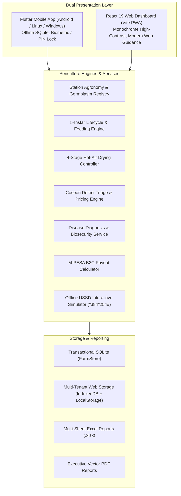

# KALRO Sericulture Farm Management System

[](https://flutter.dev)
[](https://dart.dev)
[](https://react.dev)
[](https://www.typescriptlang.org)
[](https://opensource.org/licenses/MIT)
[](#)

**KALRO Sericulture** is a mission-critical, production-grade farm management and research platform developed for Kenyan silkworm farmers, station agronomists, and extension officers. Developed in alignment with the **Kenya Agricultural and Livestock Research Organization (KALRO)** and the **National Sericulture Research Centre (NSRC)**, the system digitizes the entire sericulture value chain—from germplasm characterization and egg incubation to 5-instar feeding schedules, disease biosecurity, automated hot-air cocoon drying, commercial reeling analytics, and mobile farmer payouts.

The project features a **dual-platform architecture**:
1. **Mobile Application**: Native Flutter app (`lib/`) for Android, Linux, and Windows, engineered for offline-first rural field operations.
2. **Web Dashboard**: High-contrast, monochromatic PWA (`web_app/`) built with React 19, TypeScript, Vite, and Google Chrome Modern Web Guidance standards.

---

## Domain Science & Kenyan Sericulture Registry

The platform incorporates verified agronomic and biological protocols from *"A Manual Guide for Sericulture in Kenya"* (KALRO / NSRC):

### 1. Characterized Germplasm & Genebank Registry
* **Characterized Mulberry Varieties (11 Cultivars)**: V1, Thika, Embu, Ithaanga, Limuru, Thailand, Ichinose, Kanva 2, S54, S36, and Unknown 2.
* **Evaluated Castor Varieties (7 Varieties)**: Nuu 70, KC6, KC14, KC2, KC24, KC15, and KMC8 (essential host plants for non-mulberry Eri silkworm production).
* **Station Genebank & Research Blocks**:
  * **Genebanks**: Old Genebank, New Genebank, and Centre Genebank holding *Ex-Embu, Ex-Thika, Ex-Limuru, and Ex-Ithanga*.
  * **Evaluation Blocks**: Blocks C2, C3, C4 and D1, D2, D3, D4 evaluating 98 accessions.
  * **Highway Farm**: Collections, irrigated selections, non-irrigated plots, cross selections, and line selections.

### 2. Silkworm Strains & Breeding Tracking
* **Bombyx mori (Mulberry Silkworm)**: KSK, ATK, ICIPE, and Kinshoshowa (pure parental strains and high-vigor bivoltine/multivoltine cross-hybrids).
* **Eri Silkworm (*Philosamia ricini*)**: Polyphagous castor/kesseru feeder spinning open-ended cocoons harvested without killing the pupae.
* **Pedigree & Heterosis Tracker**: Monitors parental voltinism, cocoon yield, and heterosis vigor percentages.

### 3. Standardized 5-Instar Feeding & Bed Space Protocol
Prescribed schedules for a standard rearing box (20,000 larvae):
* **1st Instar** ($26\text{--}28^\circ\text{C}, 85\%\text{ RH}$): 300g–400g daily tender chopped leaves (top 3rd–4th leaf, $0.5\,\text{cm}^2$). Bed space $0.4\text{--}1.0\,\text{m}^2$.
* **2nd Instar** ($26\text{--}28^\circ\text{C}, 85\%\text{ RH}$): 700g–1,400g daily chopped leaves below glossy leaf. Bed space $1.0\text{--}2.0\,\text{m}^2$.
* **3rd Instar** ($24\text{--}26^\circ\text{C}, 80\%\text{ RH}$): 4kg–6kg daily green-stem leaves. Bed space expanded to $4.0\text{--}8.0\,\text{m}^2$.
* **4th Instar** ($24\text{--}25^\circ\text{C}, 75\%\text{ RH}$): 24kg–60kg whole shoots ($1.0\text{--}1.5\,\text{m}$). Bed space $8.0\text{--}16.0\,\text{m}^2$.
* **5th Instar** ($23\text{--}24^\circ\text{C}, 70\%\text{ RH}$): 40kg–200kg peak shoot feeding. Bed space $16.0\text{--}34.0\,\text{m}^2$.
* **Moulting & Bed Hygiene**: Complete feed stoppage during skin shedding; slaked agricultural lime powder dusting ($50\text{--}100\,\text{g/m}^2$) to reduce humidity and manage viral infections.

### 4. 4-Stage Automated Hot-Air Cocoon Drying
Strictly replaces traditional sun drying (which causes ultraviolet degradation, cocoon yellowing, and sericin denaturation):
* **Stage 1**: $115^\circ\text{C}$ for 60 min — pupae stifle and rapid surface desiccation.
* **Stage 2**: $100^\circ\text{C}$ for 60 min — controlled moisture release.
* **Stage 3**: $95^\circ\text{C}$ for 30 min — core pupal desiccation.
* **Stage 4**: $90^\circ\text{C}$ for 60 min — final conditioning to reach the target $40\%$ dry cocoon weight.

### 5. Cocoon Defect Triage & Market Grading
* **Defect Categories**: Thin cocoons (loose layers, low silk), Framed cocoons (frame imprints), Irregular cocoons (abnormal shape from weak larvae), Melted cocoons (pupal death and inner staining), Double cocoons (two worms spinning together), and Stained cocoons (urine/gut fluid absorption).
* **Quality Valuation**: Automatic grading into **Grade A**, **Grade B**, **Grade C**, or **Reject** based on shell ratio percentage and defect rate thresholds.

### 6. Disease Biosecurity Triage
* Differential symptom checklists and emergency biocontrol procedures for:
  * **Grasserie (Nuclear Polyhedrosis Virus)**: Milky hemolymph, shiny skin, restlessness.
  * **Pebrine (Microsporidia - *Nosema bombycis*)**: Pepper-like black spots, irregular moulting.
  * **Flacherie (Bacterial/Viral Infectious Flacherie)**: Transparent thorax, digestive liquefaction.
  * **Muscardine (Fungal - *Beauveria bassiana*)**: White chalky efflorescence, body stiffness.

---

## System Architecture



---

## Core Feature Comparison

| Capability | Flutter Mobile App (`lib/`) | React Web PWA (`web_app/`) |
|---|---|---|
| **Primary Platform** | Android, iOS, Linux, Windows | Desktop browsers, Tablets, Chrome PWA |
| **Styling & Theme** | Material 3 Sunlight-Readable Palette | Monochromatic High-Contrast (Black & White) |
| **Dark Mode Adaptation** | Dynamic ThemeMode (Light / Dark) | `color-scheme: light dark;` & `light-dark()` tokens |
| **Offline Storage** | Transactional SQLite (`FarmStore`) | Multi-tenant IndexedDB & LocalStorage |
| **Agronomy & Genebanks** | Interactive calculators & lookup screens | 5-tab Station Agronomy Hub (`StationAgronomyView`) |
| **Hot-Air Drying Timer** | 4-stage interactive countdown with audio alarms | Modal timer & SOP guide with moisture calculation |
| **Bed Space & Lime Calc** | Instar-by-instar dimension & kg calculator | Interactive batch space estimation |
| **Cocoon Grading & Pricing** | Defect tally, shell ratio %, and net payout | Commercial reeling analytics & defect grading |
| **Disease Triage** | Symptom checkbox triage with disposal guides | Interactive biosecurity diagnostic sheet |
| **Farmer Payouts** | M-PESA B2C transaction validation & receipting | Payment ledger & financial performance tracking |
| **USSD Simulation** | Complete dialer simulation (`*384*254#`, EN/SW/KIK) | Reference guide & USSD menu architecture |
| **Document Export** | 6-sheet Excel (`.xlsx`) & vector PDF | Structured CSV, signed JSON backup, PDF generator |
| **Hardware Integrations** | Tray QR code scanner/generator, TTS speech | Tray QR generator, Print-ready report sheets |

---

## Google Chrome Modern Web Guidance in `web_app/`

The React web application implements the modern browser platform recommendations from [Google Chrome Modern Web Guidance](https://github.com/GoogleChrome/modern-web-guidance-src):

1. **`dark-mode` & Color Functions**: Full operating system adaptation using `<meta name="color-scheme" content="light dark" />`, `color-scheme: light dark;`, and standard `light-dark()` CSS tokens.
2. **`browser-ui-theming`**: Standard W3C `scrollbar-color` and `scrollbar-width: thin;` replacing vendor-prefixed rules (with progressive fallback), paired with high-contrast `::selection` theming.
3. **`improve-text-layout-and-legibility`**: Typographic balance via `text-wrap: balance;` on headings and dynamic numerals; `text-wrap: pretty;` on prose and guidance notes to prevent orphan words.
4. **`soft-edge-content-fade`**: CSS linear gradient masks (`mask-image`) on horizontal navigation tabs to provide visual affordances for overflowing content.
5. **`defer-rendering-heavy-content`**: `content-visibility: auto;` with `contain-intrinsic-size: auto none auto 240px;` on below-the-fold cards to skip off-screen layout and paint until elements approach the viewport.
6. **`required-field-feedback`**: Input validation using `:user-invalid` and `:required:user-valid` so error styling appears only after direct user interaction.

---

## Directory Structure

```text
Kalro-App/
├── lib/                                # Flutter Mobile Client
│   ├── components/                     # Reusable widgets (cards, health, layout, lifecycle)
│   ├── l10n/                           # Localization resources (English & Kiswahili)
│   ├── models/                         # Domain models (Batch, Feeding, Harvest, Lifecycle)
│   ├── screens/                        # Primary screen views
│   │   ├── bed_space_lime_screen.dart       # Bed space expansion & slaked lime calculator
│   │   ├── breeding_pedigree_screen.dart    # Silkworm strain breeding & heterosis tracking
│   │   ├── cocoon_grading_screen.dart       # Cocoon defect sorting & pricing
│   │   ├── disease_triage_screen.dart       # Biosecurity symptom triage
│   │   ├── hot_air_drying_screen.dart       # 4-stage hot-air drying controller
│   │   ├── mpesa_payout_screen.dart         # M-PESA B2C farmer payout engine
│   │   └── ussd_dialer_screen.dart          # Offline *384*254# USSD simulator
│   ├── services/                       # Business logic (FarmStore SQLite, Excel, TTS, Sensors)
│   └── theme/                          # KALRO colors, typography, and contrast tokens
│
├── web_app/                            # React 19 + TypeScript Web Client
│   ├── src/
│   │   ├── components/                 # React views (Today, Batches, StationAgronomy, Audit, You)
│   │   ├── utils/                      # PDF generator, mathematical formulas, date formatters
│   │   ├── constants.ts                # Germplasm registry, feeding tables, user roles
│   │   ├── storage.ts                  # Multi-tenant LocalStorage/IndexedDB store
│   │   ├── types.ts                    # TypeScript domain definitions
│   │   └── index.css                   # Monochromatic CSS with Modern Web Guidance tokens
│   ├── index.html                      # PWA shell with color-scheme metadata
│   └── package.json                    # Dependencies & build scripts
│
├── OVERVIEW.md                         # Detailed Architectural, Domain & Agronomic Specification
├── README.md                           # Quickstart, Features & Registry Summary
└── pubspec.yaml                        # Flutter package configuration & dependencies
```

---

## Getting Started

### 1. Flutter Mobile Application

#### Prerequisites
* [Flutter SDK](https://docs.flutter.dev/get-started/install) (3.27 or higher)
* [Android SDK](https://developer.android.com/studio) (API 26+) or a physical Android/Linux/Windows device

#### Setup & Execution
```bash
# Fetch dependencies
flutter pub get

# Generate localization files
flutter gen-l10n

# Run static analysis (0 issues guaranteed)
flutter analyze

# Run unit and widget test suite
flutter test

# Launch on connected device
flutter run
```

---

### 2. React Web Application

#### Prerequisites
* [Node.js](https://nodejs.org) (v18 or higher)
* npm or yarn

#### Setup & Execution
```bash
# Navigate to web_app
cd web_app

# Install dependencies
npm install

# Start local development server
npm run dev

# Compile production build (dist/)
npm run build
```

---

## Quality Assurance & Verification

* **Flutter Static Analysis**: Checked with `flutter analyze` — **No issues found!**
* **Web Production Build**: Compiled with `tsc -b && vite build` — **Zero TypeScript/CSS errors**.
* **Browser Compatibility**: Fully compliant with modern Chrome, Edge, Safari, and Firefox.

---

## License

Developed for the **Kenya Agricultural and Livestock Research Organization (KALRO)** and the **National Sericulture Research Centre (NSRC)**. Released under the [MIT License](LICENSE).
