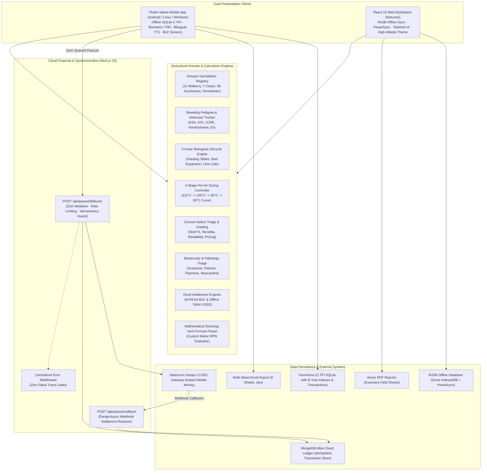
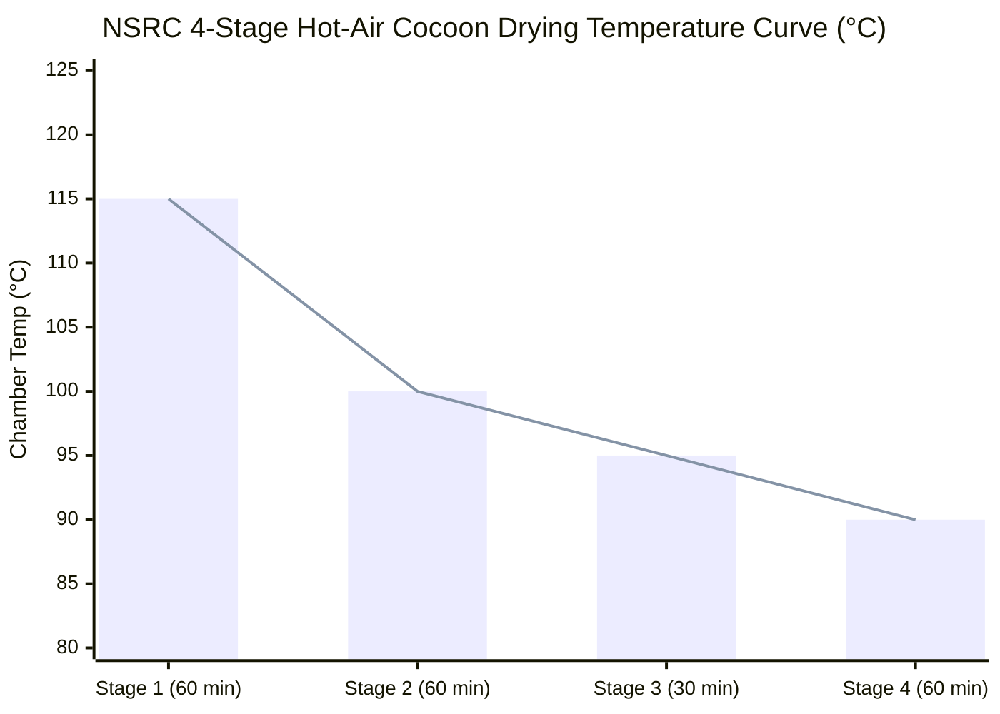

# KALRO Sericulture Farm Management & Research Operating System
## Comprehensive System Architecture, Domain Science & Engineering Overview

---

### Executive Summary

The **KALRO Sericulture Management System** is a mission-critical, enterprise operating system engineered for silkworm rearers, station agronomists, research scientists, and extension officers across Kenya. Developed in direct alignment with the **Kenya Agricultural and Livestock Research Organization (KALRO)** and the **National Sericulture Research Centre (NSRC)** in Thika, the platform digitizes and optimizes the entire sericulture value chain—from germplasm conservation and breeding pedigree tracking to 5-instar feeding schedules, disease biosecurity, 4-stage automated hot-air cocoon drying, commercial reeling analytics, and mobile farmer payouts.

Sericulture in East Africa operates under distinct environmental, agronomic, and socio-economic conditions:
* Rearing huts and station sheds are frequently situated in rural counties (e.g., Murang'a, Machakos, Kitui, Kirinyaga, Embu, Kakamega, Bungoma) with intermittent or absent cellular networks.
* Farmers handle delicate caterpillars (*Bombyx mori* and *Samia cynthia ricini* / Eri), fresh damp foliage, and bed disinfectants, demanding hands-free, sunlight-calibrated, high-contrast interfaces.
* Rural farmers predominantly utilize entry-level Android smartphones or feature phones, while station agronomists utilize desktop browsers and tablets for research trials.
* Quality standards require rigorous cocoon sorting, strict elimination of sun-drying practices to preserve sericin and fibroin integrity, and transparent grading to ensure fair farmer compensation via mobile money.

To address these requirements, this platform combines:
1. **Kenyan Germplasm & Genebank Registry**: Characterization of 11 mulberry varieties, 7 castor varieties, 98 accessions across evaluation blocks (C2–C4, D1–D4), Highway Farm, and research genebanks.
2. **Breeding Pedigree & Heterosis Modeling**: Genetic voltinism tracking, parent cross combinations (KSK, ATK, ICIPE, Kinshoshowa), and heterosis vigor calculations ($H\%$).
3. **5-Instar Lifecycle & Bed Space Management**: Mathematical feeding tables, environmental threshold surveillance, and slaked lime powder disinfection ($50\text{--}100\,\text{g/m}^2$) during moult rests.
4. **Automated 4-Stage Hot-Air Cocoon Drying**: Replaces harmful sun-drying with a staged temperature curve ($115^\circ\text{C}\to 100^\circ\text{C}\to 95^\circ\text{C}\to 90^\circ\text{C}$) to guarantee optimal reelability and $40\%$ dry cocoon weight.
5. **Commercial Cocoon Reeling & Quality Grading**: Real-time evaluation of Shell Ratio %, Renditta, Reelability %, Defect Rate %, and automated KALRO Grade A/B/C/Reject classification.
6. **Pathology & Biosecurity Triage**: Diagnostic checklists and biocontrol measures for Grasserie, Pebrine, Flacherie, and Muscardine.
7. **Rural Financial Settlement**: M-PESA B2C payout engine with idempotency keys and an offline USSD dialer simulator (`*384#`) in English, Kiswahili, and Kikuyu.
8. **Tri-Part System Architecture**: Native Flutter (Dart 3.x) with offline C FFI SQLite (`FarmStore`), React 19 + TypeScript web PWA with an executive high-albedo institutional theme adhering to Google Chrome Modern Web Guidance standards, and a Next.js 15 App Router cloud financial backend following Node.js Best Practices.

---

## 1. System Architecture & Tri-Part Engineering

The platform consists of three interoperable components sharing identical domain rules, mathematical models, and data interchange formats:
* **Mobile Client (`lib/`)**: Native Flutter (Dart 3.11+ / Flutter 3.27+) targeted at Android, Linux, and Windows, featuring on-device SQLite via C FFI with B-tree indexes, atomic bulk transactions, biometric/PIN access control, BLE sensor logging, and offline TTS audio guidance.
* **Web Client (`web_app/`)**: Progressive Web Application (React 19 + TypeScript + Vite) targeted at research station workstations, desktop browsers, and tablets, featuring a `bulletproof-react` feature architecture (`features/`), RxDB offline storage with Dexie (IndexedDB), PowerSync PostgreSQL replication, Tailwind CSS v4, and a consolidated Executive Operations Command Card.
* **Backend API (`backend_api/`)**: Next.js 15 App Router serverless backend managing Safaricom Daraja 2.0 M-PESA B2C disbursements with strict Zod boot-up validation, centralized error handling, sliding-window rate limiting, and database-level idempotency protection.



### Technology Matrix

| Component | Flutter Mobile Application | React Web PWA | Next.js 15 Backend API |
|---|---|---|---|
| **Core Framework** | Flutter 3.27+ / Dart 3.11+ | React 19.3+ / TypeScript 5.9+ | Next.js 15 App Router (Node.js) |
| **Architecture** | Service-Repository Pattern | Bulletproof Feature Modules (`features/`) | Modular Controllers & Service Route Handlers |
| **Styling & Theme** | Material 3 Sunlight-Readable Palette | Executive High-Albedo Institutional (`#FFFFFF`, `#16A34A`) | Structured REST JSON Responses |
| **Modern Standards** | Native Canvas / Impeller | Google Chrome Modern Web Guidance & Tailwind v4 | Node.js Best Practices & Zod Boot-Up Guard |
| **Local Persistence** | `sqlite3` via C FFI (Indexed B-Trees) | `RxDB` on Dexie (IndexedDB) + `localStorage` | Stateless / MongoDB Connection Pool |
| **Replication / Sync** | Local file backup / signed JSON | PowerSync PostgreSQL Live Replication | REST Endpoints for Queued Offline Batches |
| **Financial / USSD** | Offline M-PESA calculation & USSD dialer | Station finance ledger & USSD simulator | Live Safaricom Daraja B2C & Webhooks |
| **Quality Assurance** | 125 Automated Unit & Widget Tests | Zero-error Vite Build (1.42s) | 100% Security & Idempotency Test Suite |

---

## 2. Characterized Kenyan Germplasm & Genebank Registry

The platform incorporates verified taxonomic profiles from NSRC Thika for both host foodplants and insect lines:

### 2.1 Characterized Mulberry Varieties (11 Cultivars)
1. **V1 (Vishva-1)**: High-yielding, moisture-retaining cultivar; ideal for young Chawki larvae (instars 1–3). 75–80% leaf moisture.
2. **Thika**: Local NSRC selection adapted to Kiambu county soils; excellent rooting and high biomass.
3. **Embu**: Drought-tolerant selection with dense internodes; suited to semi-arid Eastern province zones.
4. **Ithaanga**: High-vigor selection with tender foliage; provides early spring flush.
5. **Limuru**: High-altitude cold-tolerant selection; resists powdery mildew at elevation (> 2,000m).
6. **Thailand**: Broad-leaf, thick-lamina selection; superior for voracious 5th instar feeding.
7. **Ichinose**: Japanese variety with high protein content; supports heavy silk gland synthesis.
8. **Kanva 2 (M5)**: Reliable general-purpose cultivar with high field survivability.
9. **S54**: Rapid-growing variety with high moisture retention during dry seasons.
10. **S36**: High-protein leaf with excellent digestible crude protein (DCP) for late instars.
11. **Unknown 2**: Preserved historical accession under continuous evaluation at NSRC Thika.

### 2.2 Evaluated Castor Varieties (7 Cultivars)
Host plants for the non-mulberry Eri silkworm (*Samia cynthia ricini*):
1. **Nuu 70**: High-biomass seed and leaf producer; deep taproot system for arid counties.
2. **KC6**: Kenyan Castor selection 6; smooth non-waxy leaves preferred by young Eri larvae.
3. **KC14**: High-oil, high-biomass selection; dense branching.
4. **KC2**: Early-maturing variety with rapid seed germination.
5. **KC24**: Heavy foliage producer with superior palatability.
6. **KC15**: Resistant to leafhoppers and bacterial blight.
7. **KMC8**: Advanced characterized line; superior drought resilience.

---

## 3. Silkworm Breeding, Pedigree & Heterosis Tracker

* **Bombyx mori Parental Lines**:
  * **KSK**: Kenyan Sericulture K-strain (bivoltine, pure white oval cocoons, high silk ratio > 22%).
  * **ATK**: Adapted Tropical K-strain (robust against temperature and humidity fluctuations).
  * **ICIPE Crosses**: Multivoltine × Bivoltine hybrids optimized for tropical rearing conditions.
  * **Kinshoshowa**: Classic Japanese parental bivoltine line used for hybrid seed production.
* **Heterosis Calculation ($H\%$)**:
  $$\text{Heterosis } (H\%) = \frac{F_1 - \text{MP}}{\text{MP}} \times 100$$
  where $F_1$ is the first-generation hybrid performance and $\text{MP}$ is the mid-parent value:
  $$\text{MP} = \frac{P_1 + P_2}{2}$$

---

## 4. Standardized 5-Instar Feeding & Bed Space Protocol

Rearing calculations for a standard commercial package of 20,000 larvae:

| Instar | Duration (Days) | Ideal Temp (°C) | Ideal RH (%) | Daily Ration (20k Larvae) | Bed Area ($m^2$) | Feeding & Bed Guidelines |
|---|---|---|---|---|---|---|
| **1st Instar** | 3 – 4 | 26 – 28 | 85 | 300g – 400g | 0.4 – 1.0 | Top 3rd–4th tender leaf, finely chopped ($0.5\,\text{cm}^2$). Bed cleaning once before 1st moult. |
| **2nd Instar** | 2 – 3 | 26 – 28 | 85 | 700g – 1,400g | 1.0 – 2.0 | Tender leaves below glossy leaf, chopped ($1.0\,\text{cm}^2$). Clean bed once after moult. |
| **3rd Instar** | 3 – 4 | 24 – 26 | 80 | 4.0kg – 6.0kg | 4.0 – 8.0 | Green-stem leaves, coarsely cut. Chawki rearing concludes at end of 3rd instar. |
| **4th Instar** | 4 – 5 | 24 – 25 | 75 | 24kg – 60kg | 8.0 – 16.0 | Whole shoots ($1.0\text{--}1.5\,\text{m}$) fed 3–4 times daily. Bed cleaning every second day. |
| **5th Instar** | 6 – 8 | 23 – 24 | 70 | 40kg – 200kg | 16.0 – 34.0 | Voracious peak feeding (85% of lifetime forage). Mount on day 7–8 when larvae turn translucent. |
| **Moult Rests** | 18 – 48 hrs | 24 – 25 | 65 – 70 | **0.0g (FASTING)** | Unchanged | Complete feed withholding. Dust bed with dry slaked agricultural lime ($50\text{--}100\,\text{g/m}^2$). |

---

## 5. Automated 4-Stage Hot-Air Cocoon Drying

Traditional sun-drying denatures the silk protein sericin, yellows white fibroin filaments, and creates reelability breaks. The platform automates the NSRC 4-stage hot-air curve:



* **Target Outcome**: Exactly **40% dry cocoon weight** ($\text{Dry Wt} = \text{Fresh Wt} \times 0.40$).
* **Pupal Stifling**: Immediate mortality of the pupa inside the cocoon within the first 60 minutes, preventing metamorphosis into a moth that would pierce the shell and ruin the continuous silk bave.

---

## 6. Cocoon Defect Triage, Reeling Analytics & Commercial Pricing

### 6.1 Defect Categories (50-Cocoon Random Sample)
1. **Thin Cocoons**: Deficient shell layers from malnourished larvae.
2. **Framed Cocoons**: Shell dented by spinning frame corners.
3. **Irregular Cocoons**: Abnormal morphology caused by disease or thermal stress.
4. **Melted Cocoons**: Dead pupa decomposing inside the shell, staining the filament.
5. **Double Cocoons**: Two larvae spinning in close contact; filaments entangle, unreelable.
6. **Stained Cocoons**: External or internal contamination from pupal fluids or urine.
7. **Pierced Cocoons**: Pupa emerged as moth or parasitic uzi fly maggot escaped.

### 6.2 Mathematical Formulas for Quality Grading
* **Shell Ratio Percentage ($SR\%$)**:
  $$SR\% = \frac{\text{Shell Weight (g)}}{\text{Total Cocoon Weight (g)}} \times 100$$
* **Estimated Renditta ($R$)**:
  $$\text{Renditta} = \frac{100}{SR\% \times \text{Reelability Rate}} \approx \frac{100}{SR\% \times 0.82}$$
* **Commercial Grade Allocation**:
  * **Grade A**: $SR\% \ge 20\%$, Defects $\le 6\%$ (KES 950/kg).
  * **Grade B**: $SR\% = 16.0\text{--}19.9\%$, Defects $\le 12\%$ (KES 800/kg).
  * **Grade C**: $SR\% < 16.0\%$ or Defects $> 12\%$ (KES 600/kg).
  * **Reject**: Moldy, decomposed, or crushed lots.

---

## 7. Silkworm Pathology, Biosecurity & Disease Triage

| Disease | Pathogen | Primary Diagnostic Signs | Biosecurity & Disposal Protocol |
|---|---|---|---|
| **Grasserie** | Nuclear Polyhedrosis Virus (BmNPV) | Worms crawl restlessly along tray edges; shiny fragile skin; milky hemolymph leaking from body. | Remove diseased larvae using forceps into 5% formalin. Dust entire bed with slaked lime. Incinerate diseased stock. |
| **Pebrine** | Microsporidian (*Nosema bombycis*) | Pepper-like microscopic black spots; uneven growth; larvae fail to moult and die slowly. | Transovarial quarantine: immediate batch condemnation. Burn all trays, paper, and litter. Disinfect shed with 2% formalin. |
| **Flacherie** | Infectious Flacherie Virus & *Bacillus* | Lethargic flaccid worms; swollen transparent thorax; black foul-smelling digestive liquefaction. | Discontinue wet or fermented leaf feeding. Clean bed daily. Spray 2% bleaching powder solution on floors. |
| **Muscardine** | Fungus (*Beauveria bassiana*) | Red/brown spots on cuticle; larvae stiffen like chalk; white chalky fungal mycelium covers corpse. | Reduce humidity below 70%. Dust bed with Dithane M-45 (Captan) mixed with slaked lime (1:9 ratio). |

---

## 8. Data Persistence, Performance & Security

### 8.1 `FarmStore` SQLite Engine with C FFI Optimizations (Flutter Mobile)
* **Dedicated B-Tree Indexes**: Created `CREATE INDEX IF NOT EXISTS idx_batches_id ON batches(id)`, `idx_logs_batch_id ON logs(batch_id)`, `idx_logs_created_at ON logs(created_at)`, and `idx_batches_stage ON batches(json_extract(data, '$.stage'))` eliminating full-table scans.
* **Bulk Insert Transactions**: Replaced sequential disk I/O writes with SQLite transactions (`db.execute('BEGIN TRANSACTION') ... 'COMMIT'`) for high-frequency BLE sensor data (every 15 minutes), preventing I/O bottlenecks.
* **Leak-Free Resource Cleanup**: Full connection and statement cursor termination in a centralized `dispose()` method.

### 8.2 RxDB Offline Synchronization Engine (React Web)
* **Dexie IndexedDB Engine**: Stores collections in local browser IndexedDB instances with full ACID compliance.
* **PowerSync Live Replication**: Transparently synchronizes local RxDB collections with central NSRC PostgreSQL servers via web workers, maintaining offline queues and automatic conflict resolution.

### 8.3 Node Best Practices & Security Guard (Next.js 15 Backend API)
* **Strict Secrets Guard (`lib/env.ts`)**: Boot-up environment variable validation using Zod. Fails fast if `DARAJA_CONSUMER_KEY`, `DARAJA_CONSUMER_SECRET`, or `MONGODB_URI` are missing or malformed.
* **Centralized Error Handling (`lib/errors.ts`)**: Catches all synchronous and asynchronous errors, formatting operational errors into standard JSON responses and concealing stack traces and internal paths in production.
* **Payload Validation (`lib/validation.ts`)**: Strict Zod schemas validating phone formats (`254...`), amount boundaries (KES 10 - 150,000), offline IDs, and rejecting unexpected injected keys via `.strict()`.
* **Idempotency Key Engine (`lib/idempotency.ts`)**: Database-level idempotency key mechanism in MongoDB preventing rural network retries from double-paying cocoon disbursements.
* **Sliding-Window Rate Limiting (`lib/rate-limiter.ts`)**: In-memory sliding-window limiter protecting disbursement endpoints from abuse.

---

## 9. Comprehensive Codebase Directory Map

```text
Kalro-App/
├── backend_api/                                # Next.js 15 Cloud Financial Backend
│   ├── app/                                    # App Router endpoints
│   │   ├── api/payout/disburse/                # POST payout disburse handler with idempotency
│   │   └── api/payout/callback/                # POST Daraja webhook receiver
│   ├── lib/                                    # Security & database infrastructure
│   │   ├── daraja.ts                           # Daraja 2.0 OAuth token caching & B2C dispatch
│   │   ├── env.ts                              # Strict Zod boot-up secrets validation
│   │   ├── errors.ts                           # Central error handler (zero stack leaks)
│   │   ├── idempotency.ts                      # Idempotency engine against double spending
│   │   ├── mongodb.ts                          # MongoDB Atlas connection pooling
│   │   ├── rate-limiter.ts                     # Sliding-window rate limiter
│   │   └── validation.ts                       # Strict Zod disbursement payload schemas
│   ├── test_backend.ts                         # Comprehensive security test suite
│   └── package.json                            # Next.js 15, Zod, MongoDB dependencies
│
├── lib/                                        # Native Flutter Cross-Platform Client
│   ├── components/                             # Granular UI widgets (cards, health, buttons, lifecycle)
│   ├── constants/                              # System colors, typography, sericulture constants
│   ├── l10n/                                   # Bilingual EN/SW ARB localization catalogs
│   ├── models/                                 # Immutable Domain Data Models (Batch, Feeding, Harvest)
│   ├── screens/                                # Primary Mobile Screen Views
│   │   ├── rearing_hub_screen.dart             # "Today" routine dashboard
│   │   ├── batches_screen.dart                 # Active & historical batches list
│   │   ├── bed_space_lime_screen.dart          # Bed space expansion & slaked lime calculator
│   │   ├── breeding_pedigree_screen.dart       # Silkworm strain breeding & heterosis tracking
│   │   ├── cocoon_grading_screen.dart          # Cocoon defect sorting & pricing
│   │   ├── disease_triage_screen.dart          # Biosecurity symptom triage & containment
│   │   ├── hot_air_drying_screen.dart          # 4-stage hot-air drying controller
│   │   ├── mpesa_payout_screen.dart            # M-PESA B2C farmer payout engine
│   │   └── ussd_dialer_screen.dart             # Offline *384# USSD simulator
│   ├── services/                               # Business Logic & Repositories
│   │   ├── farm_store.dart                     # SQLite C FFI transactional engine with B-tree indexes
│   │   ├── lifecycle_engine.dart               # Instar timeline predictor with climate adjustments
│   │   ├── cocoon_analytics_service.dart       # Renditta, shell %, defect rate & commercial grading
│   │   ├── formula_engine.dart                 # Shunting-yard RPN custom formula parser
│   │   ├── leaf_ledger_service.dart            # 14-day leaf consumption & depletion forecaster
│   │   ├── excel_export_service.dart           # 6-sheet .xlsx Excel generator
│   │   └── sensor_manager_service.dart         # BLE & manual microclimate sync with bulk transactions
│   └── theme/                                  # KALRO sunlight-readable theme definitions
│
├── web_app/                                    # React 19 + TypeScript Progressive Web App
│   ├── src/
│   │   ├── components/                         # Global Shell Components
│   │   │   ├── Header.tsx                      # Modern brand header & PowerSync indicator
│   │   │   ├── Navigation.tsx                  # Main tab navigation bar
│   │   │   └── TodayView.tsx                   # Executive Operations Command Center
│   │   ├── features/                           # Bulletproof React Domain Modules
│   │   │   ├── agronomy/                       # StationAgronomyView & germplasm catalog
│   │   │   ├── batches/                        # Batch list, QR dialogs, creation modals
│   │   │   ├── finance/                        # Financial ledger & M-PESA reconciliation
│   │   │   └── health/                         # Disease diagnostic triage & biosecurity
│   │   ├── lib/rxdb/                           # RxDB offline database & Dexie storage setup
│   │   ├── constants.ts                        # Kenyan germplasm registry & NSRC feeding tables
│   │   ├── types.ts                            # TypeScript domain model definitions
│   │   ├── utils/                              # PDF generators, RPN formula parser, math helpers
│   │   └── index.css                           # High-albedo institutional theme & Tailwind v4
│   ├── vite.config.ts                          # Vite build configuration with @tailwindcss/vite
│   └── package.json                            # Web dependencies and build scripts
│
├── docs/                                       # Centralized Platform Documentation
│   ├── README.md                               # Documentation Index & Roadmap
│   ├── OVERVIEW.md                             # Architectural, Domain & Agronomic Specification
│   ├── PROJECT_MASTER_DOCUMENTATION.md         # Complete Technical Reference Manual
│   ├── web_app.md                              # React 19 PWA & RxDB Architecture Guide
│   └── backend_api.md                          # Next.js 15 & Safaricom Daraja B2C Security Guide
│
├── test/                                       # Flutter Automated QA Suite (125 Tests)
└── README.md                                   # Quickstart, Architecture & Features Summary
```

---

## 10. Operational Guidelines for Rural Deployment & Station Management

1. **Sunlight Legibility & High Contrast**:
   Both Flutter and React clients adhere strictly to high-contrast guidelines. In bright outdoor sunlight or dark mud-walled rearing sheds, critical figures (temperatures, feed weights, moult alerts) remain instantly readable with WCAG AAA contrast ratios.
2. **Autonomous Offline Execution**:
   The platform never halts due to lack of network connection. All data entry, calculations, and local exports function seamlessly without network requests.
3. **Double-Payment Prevention**:
   Rural network drops during mobile financial syncing cannot cause double disbursements due to stateful idempotency key leasing in the backend API.
4. **Data Portability for Extension Services**:
   When agricultural extension agents or research scientists visit rural farms, data can be transferred via QR code scanning or exported to an unencrypted 6-sheet `.xlsx` workbook on an SD card or USB drive.

---
*Developed for the Kenya Agricultural and Livestock Research Organization (KALRO) and the National Sericulture Research Centre (NSRC).*
