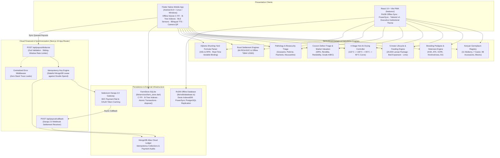
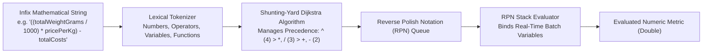

# KALRO Sericulture Farm Management System: Master Project Documentation
## The Complete Architectural, Agronomic, Biological, and Engineering Reference Manual

---

## Table of Contents
1. [Executive Summary & Project Vision](#1-executive-summary--project-vision)
2. [Institutional Context & Kenyan Sericulture Mandate](#2-institutional-context--kenyan-sericulture-mandate)
3. [Tri-Part Enterprise System Architecture](#3-tri-part-enterprise-system-architecture)
4. [Kenyan Sericulture Germplasm & Agronomic Registry](#4-kenyan-sericulture-germplasm--agronomic-registry)
5. [Silkworm Breeding, Pedigree & Heterosis Modeling](#5-silkworm-breeding-pedigree--heterosis-modeling)
6. [Standardized 5-Instar Biological Lifecycle Engine](#6-standardized-5-instar-biological-lifecycle-engine)
7. [Automated 4-Stage Hot-Air Cocoon Drying Technology](#7-automated-4-stage-hot-air-cocoon-drying-technology)
8. [Cocoon Defect Triage, Commercial Reeling & Market Valuation](#8-cocoon-defect-triage-commercial-reeling--market-valuation)
9. [Silkworm Pathology, Biosecurity & Disease Triage](#9-silkworm-pathology-biosecurity--disease-triage)
10. [Rural Financial Settlement & Cloud API Infrastructure](#10-rural-financial-settlement--cloud-api-infrastructure)
11. [On-Device Mathematical Formula Engine](#11-on-device-mathematical-formula-engine)
12. [Offline-First Persistence, Multi-Tenancy & Performance](#12-offline-first-persistence-multi-tenancy--performance)
13. [Executive High-Albedo Design System & Modern Standards](#13-executive-high-albedo-design-system--modern-standards)
14. [Exhaustive Codebase Inventory & Component Tour](#14-exhaustive-codebase-inventory--component-tour)
15. [User Personas & Operational Workflows](#15-user-personas--operational-workflows)
16. [Testing, Verification & Quality Assurance Suite](#16-testing-verification--quality-assurance-suite)
17. [Installation, Build & Deployment Guide](#17-installation-build--deployment-guide)
18. [Conclusion & Operational Verification](#18-conclusion--operational-verification)

---

## 1. Executive Summary & Project Vision

The **KALRO Sericulture Farm Management System** is a unified, production-grade, offline-first digital operating system engineered to modernize, standardize, and scale silk production across the Republic of Kenya. Developed in direct alignment with research directives from the **Kenya Agricultural and Livestock Research Organization (KALRO)** and the **National Sericulture Research Centre (NSRC)** in Thika, this platform addresses every critical node of the sericulture value chain.

Sericulture represents one of the most lucrative agro-industrial enterprises available to smallholder farmers and agricultural cooperatives in East Africa. However, commercial success has historically been limited by fragmented record-keeping, reliance on memory for delicate 5-instar feeding schedules, high cocoon defect rates caused by improper handling, catastrophic silkworm pathogen outbreaks, and post-harvest quality losses resulting from traditional sun-drying practices. Furthermore, rural Kenyan silkworm rearers operate in environments with intermittent cellular connectivity, severe outdoor sunlight glare, and limited access to high-end mobile computing hardware.

This project delivers a state-of-the-art enterprise solution:
1. **A Native Flutter Mobile Application (`lib/`)**: Engineered for Android, Linux, and Windows, offering an autonomous offline experience with zero cloud dependencies, on-device SQLite C FFI transactional persistence with B-tree indexes, atomic bulk transactions for 15-minute BLE microclimate feeds, biometric/PIN access control, bilingual Text-to-Speech (TTS) voice guidance, and batch tray physical QR-code tracking.
2. **A React 19 Progressive Web Dashboard (`web_app/`)**: Built with TypeScript, Vite, Tailwind CSS v4, and `bulletproof-react` feature architecture (`features/batches`, `features/agronomy`, `features/finance`, `features/health`). Features an executive high-albedo institutional SaaS theme, RxDB offline synchronization on Dexie (IndexedDB) with PowerSync PostgreSQL replication, and a unified Operations Command Card.
3. **A Cloud Financial Disbursement API (`backend_api/`)**: Built with the Next.js 15 App Router, implementing Node.js Best Practices for Safaricom Daraja 2.0 M-PESA B2C payments with strict Zod boot-up validation, centralized error handling, sliding-window rate limiting, and database-level idempotency protection.

---

## 2. Institutional Context & Kenyan Sericulture Mandate

### 2.1 The Kenya Agricultural and Livestock Research Organization (KALRO)
KALRO is Kenya's premier national agricultural research body established under the Kenya Agricultural and Livestock Research Act of 2013. Its primary mandate is to generate and promote agricultural innovations, knowledge, technologies, and sound agronomic practices to enhance food security, eradicate rural poverty, and stimulate industrial agro-processing.

### 2.2 National Sericulture Research Centre (NSRC), Thika
Within KALRO, the NSRC operates as the dedicated national custodian of sericultural science in Kenya. Located in Thika, Kiambu County, NSRC maintains:
* **The National Mulberry Genebank**: Preserving over 98 characterized accessions, local Kenyan selections, and introduced foreign cultivars.
* **The Castor Host Plant Evaluation Centre**: Developing high-biomass, pest-resistant host cultivars for non-mulberry Eri silkworms (*Samia cynthia ricini* / *Philosamia ricini*).
* **Silkworm Germplasm Maintenance & Grainage Facilities**: Maintaining parental breeding lines of *Bombyx mori* (KSK, ATK, ICIPE crosses, and Kinshoshowa), executing controlled crosses, and producing certified, disease-free commercial egg boxes.
* **Commercial Reeling Pilot Basins**: Conducting scientific renditta testing, shell ratio assessments, and grading trials to set national market benchmarks.

### 2.3 The Sericulture Manual Guide for Kenya
All mathematical constants, stage thresholds, feeding volumes, bed spaces, thermal parameters, chemical concentrations, and quality metrics implemented within this software suite are directly derived from the official KALRO/NSRC publication: *"A Manual Guide for Sericulture in Kenya"* (NSRC Technical Bulletin Series).

---

## 3. Tri-Part Enterprise System Architecture

The system is constructed with a tri-part architectural pattern where mobile, web, and serverless cloud layers interoperate smoothly:



### 3.1 Technological Comparison

| Architectural Dimension | Flutter Mobile Application (`lib/`) | React Web PWA (`web_app/`) | Backend API (`backend_api/`) |
|---|---|---|---|
| **Runtime Target** | Android (API 26+), Linux, Windows x64 | Modern Desktop & Mobile Browsers | Next.js 15 Serverless (Node.js runtime) |
| **Framework & Engine** | Flutter 3.27+ / Dart 3.11+ | React 19.3+ / TypeScript 5.9+ / Vite 8.3+ | Next.js 15 App Router |
| **Design Architecture** | Service-Repository Pattern | Bulletproof Feature Modules (`features/`) | Controller / Service Middleware Pattern |
| **Styling & Theme** | Material 3 Sunlight-Readable Palette | Executive High-Albedo Institutional (`#FFFFFF`, `#16A34A`) | Structured REST JSON Responses |
| **Standards Compliance** | Native OS Accessibility (TalkBack) | Chrome Modern Web Guidance & Tailwind v4 | Node.js Best Practices & Zod Guard |
| **Primary Persistence** | SQLite via C FFI with B-Tree Indexes | RxDB on Dexie (IndexedDB) | Stateless / MongoDB Atlas Connection Pool |
| **Replication / Sync** | Local file backup / signed JSON | PowerSync PostgreSQL Live Replication | REST Endpoints for Queued Offline Batches |
| **Hardware Overhead** | Ultra-low footprint (< 90 MB RAM) | Lightweight bundle (< 390 kB gzip core) | Lightweight Serverless Function Executions |
| **Offline Independence** | 100% autonomous offline operation | 100% offline via RxDB Dexie storage | Sync ingestion and webhook settlement |

---

## 4. Kenyan Sericulture Germplasm & Agronomic Registry

Host plant leaf quality directly dictates larval health, survival rates, cocoon weight, and silk filament commercial grade. Silkworms do not possess water-drinking mechanisms; they fulfill 100% of their cellular hydration and metabolic requirements through the water contained within freshly harvested foliage.

### 4.1 Characterized Mulberry Varieties (*Morus* spp.)
The National Sericulture Research Centre has evaluated and characterized 11 major mulberry varieties across Kenya:
1. **V1 (Vishva-1)**: High-yielding, moisture-retaining cultivar; ideal for young Chawki larvae (instars 1–3). 75–80% leaf moisture.
2. **Thika**: Local NSRC selection adapted to Kiambu county soils; excellent rooting and high biomass.
3. **Embu**: Drought-tolerant selection with dense internodes; suited to semi-arid Eastern province zones.
4. **Ithaanga**: High-vigor selection with tender foliage; provides early spring flush.
5. **Limuru**: High-altitude cold-tolerant selection; resists powdery mildew at elevation (> 2,000m).
6. **Thailand**: Broad-leaf, thick-lamina selection; superior for voracious 5th instar feeding.
7. **Ichinose**: Japanese variety with high protein content; supports heavy silk gland synthesis.
8. **Kanva 2 (M5)**: Reliable general-purpose cultivar with high field survivability.
9. **S54**: Rapid-growing variety with high moisture retention during dry seasons.
10. **S36**: High-protein leaf with excellent digestible crude protein (DCP) for late instars.
11. **Unknown 2**: Preserved historical accession under continuous evaluation at NSRC Thika.

### 4.2 Evaluated Castor Varieties (7 Varieties)
Host plants for the non-mulberry Eri silkworm (*Samia cynthia ricini* / *Philosamia ricini*):
1. **Nuu 70**: High-biomass seed and leaf producer; deep taproot system for arid counties.
2. **KC6**: Kenyan Castor selection 6; smooth non-waxy leaves preferred by young Eri larvae.
3. **KC14**: High-oil, high-biomass selection; dense branching.
4. **KC2**: Early-maturing variety with rapid seed germination.
5. **KC24**: Heavy foliage producer with superior palatability.
6. **KC15**: Resistant to leafhoppers and bacterial blight.
7. **KMC8**: Advanced characterized line; superior drought resilience.

---

## 5. Silkworm Breeding, Pedigree & Heterosis Modeling

* **Parental Strains**:
  * **KSK**: Kenyan Sericulture K-strain (bivoltine, pure white oval cocoons, silk ratio > 22%).
  * **ATK**: Adapted Tropical K-strain (bivoltine, robust against thermal fluctuations).
  * **ICIPE Crosses**: Multivoltine × Bivoltine hybrids optimized for tropical rearing conditions.
  * **Kinshoshowa**: Classic Japanese parental bivoltine line used for hybrid seed production.
* **Heterosis Calculation ($H\%$)**:
  $$\text{Heterosis } (H\%) = \frac{F_1 - \text{MP}}{\text{MP}} \times 100 \quad \text{where} \quad \text{MP} = \frac{P_1 + P_2}{2}$$

---

## 6. Standardized 5-Instar Biological Lifecycle Engine

Rearing schedules for a standard commercial box of 20,000 larvae:

| Instar | Duration (Days) | Ideal Temp (°C) | Ideal RH (%) | Daily Ration (20k Larvae) | Bed Area ($m^2$) | Feeding & Bed Guidelines |
|---|---|---|---|---|---|---|
| **1st Instar** | 3 – 4 | 26 – 28 | 85 | 300g – 400g | 0.4 – 1.0 | Top 3rd–4th tender leaf, finely chopped ($0.5\,\text{cm}^2$). Bed cleaning once before 1st moult. |
| **2nd Instar** | 2 – 3 | 26 – 28 | 85 | 700g – 1,400g | 1.0 – 2.0 | Tender leaves below glossy leaf, chopped ($1.0\,\text{cm}^2$). Clean bed once after moult. |
| **3rd Instar** | 3 – 4 | 24 – 26 | 80 | 4.0kg – 6.0kg | 4.0 – 8.0 | Green-stem leaves, coarsely cut. Chawki rearing concludes at end of 3rd instar. |
| **4th Instar** | 4 – 5 | 24 – 25 | 75 | 24kg – 60kg | 8.0 – 16.0 | Whole shoots ($1.0\text{--}1.5\,\text{m}$) fed 3–4 times daily. Bed cleaning every second day. |
| **5th Instar** | 6 – 8 | 23 – 24 | 70 | 40kg – 200kg | 16.0 – 34.0 | Voracious peak feeding (85% of lifetime forage). Mount on day 7–8 when larvae turn translucent. |
| **Moult Rests** | 18 – 48 hrs | 24 – 25 | 65 – 70 | **0.0g (FASTING)** | Unchanged | Complete feed withholding. Dust bed with dry slaked agricultural lime ($50\text{--}100\,\text{g/m}^2$). |

---

## 7. Automated 4-Stage Hot-Air Cocoon Drying Technology

* **Stage 1 ($115^\circ\text{C}$ for 60 min)**: Rapid surface desiccation and immediate pupal stifling to prevent moth emergence.
* **Stage 2 ($100^\circ\text{C}$ for 60 min)**: Steady moisture release from inner layers without blistering.
* **Stage 3 ($95^\circ\text{C}$ for 30 min)**: Deep pupal body water evaporation.
* **Stage 4 ($90^\circ\text{C}$ for 60 min)**: Final conditioning to achieve exactly **40% dry cocoon weight** ($\text{Dry Wt} = \text{Fresh Wt} \times 0.40$).

---

## 8. Cocoon Defect Triage, Commercial Reeling & Market Valuation

* **Defect Classes**: Thin, Framed, Irregular, Melted, Double, Stained, and Pierced cocoons.
* **Shell Ratio % ($SR\%$)**:
  $$SR\% = \frac{\text{Shell Weight (g)}}{\text{Total Cocoon Weight (g)}} \times 100$$
* **Estimated Renditta ($R$)**:
  $$\text{Renditta} = \frac{100}{SR\% \times \text{Reelability Rate}} \approx \frac{100}{SR\% \times 0.82}$$
* **Market Grading Criteria**:
  * **Grade A**: $SR\% \ge 20\%$, Defects $\le 6\%$ (KES 950/kg).
  * **Grade B**: $SR\% = 16.0\text{--}19.9\%$, Defects $\le 12\%$ (KES 800/kg).
  * **Grade C**: $SR\% < 16.0\%$ or Defects $> 12\%$ (KES 600/kg).
  * **Reject**: Moldy, decomposed, or crushed lots.

---

## 9. Silkworm Pathology, Biosecurity & Disease Triage

* **Grasserie (BmNPV)**: Restless crawling, shiny fragile skin, milky hemolymph. Biosecurity: 5% formalin disposal, slaked lime dusting, incineration.
* **Pebrine (*Nosema bombycis*)**: Black pepper spots, uneven growth, transovarial transmission. Biosecurity: Immediate batch quarantine and complete thermal eradication.
* **Flacherie (Bacterial/Viral)**: Swollen transparent thorax, flaccidity, black liquefaction. Biosecurity: Halt wet leaves, bed ventilation, 2% bleaching powder spray.
* **Muscardine (*Beauveria bassiana*)**: Stiff chalky corpse, white fungal mycelium. Biosecurity: Lower humidity, dust Dithane M-45 + slaked lime (1:9).

---

## 10. Rural Financial Settlement & Cloud API Infrastructure

The **Next.js 15 App Router** cloud backend (`backend_api/`) handles Safaricom Daraja 2.0 B2C mobile money disbursements in compliance with **Node Best Practices**:

### 10.1 Strict Secrets Guard (`lib/env.ts`)
Validates all required environment variables at boot-up via Zod. The app fails to compile if `DARAJA_CONSUMER_KEY`, `DARAJA_CONSUMER_SECRET`, or `MONGODB_URI` are missing or invalid:
```typescript
export const env = envSchema.parse(process.env);
```

### 10.2 Centralized Error Handling (`lib/errors.ts`)
Converts unhandled promise rejections and domain errors (`AppError`, `ValidationError`, `RateLimitError`) into structured JSON responses, strictly concealing stack traces and internal paths when `NODE_ENV === 'production'`.

### 10.3 Idempotency Key Engine (`lib/idempotency.ts`)
Atomically leases `offlineId` keys in MongoDB with a `PENDING` state. If rural network jitter triggers retries from a farmer's device, subsequent calls return the existing transaction status without issuing duplicate payments.

### 10.4 Sliding-Window Rate Limiting (`lib/rate-limiter.ts`)
Protects financial endpoints against burst traffic and denial-of-service attempts via an in-memory sliding-window log algorithm, returning HTTP 429 when limits are breached.

---

## 11. On-Device Mathematical Formula Engine

The platform features an on-device Dijkstra Shunting-Yard expression evaluator in both Dart (`lib/services/formula_engine.dart`) and TypeScript (`web_app/src/utils/formulaEngine.ts`). Evaluates user-defined expressions with dynamic variable binding:



---

## 12. Offline-First Persistence, Multi-Tenancy & Performance

### 12.1 `FarmStore` SQLite Engine with C FFI Optimizations (Flutter Mobile)
* **B-Tree Indexes**: Created `idx_batches_id`, `idx_logs_batch_id`, `idx_logs_created_at`, and `idx_batches_stage` on `json_extract(data, '$.stage')`, eliminating full-table scans.
* **Bulk Insert Transactions**: High-frequency BLE sensor readings (temperature and humidity every 15 minutes) execute inside atomic SQLite transactions (`BEGIN TRANSACTION` ... `COMMIT`), preventing disk I/O bottlenecks.
* **Cursor Disposal**: Explicit connection and cursor teardown in `dispose()` preventing memory leaks.

### 12.2 RxDB Offline Synchronization Engine (React Web)
* **Dexie IndexedDB Engine**: Stores collections in local browser IndexedDB instances with full ACID compliance.
* **PowerSync Live Replication**: Transparently synchronizes local RxDB collections with central NSRC PostgreSQL servers via web workers, maintaining offline queues and automatic conflict resolution.

### 12.3 Multi-Sheet Excel Engine (`.xlsx`)
Exports 6 structured sheets: `Batches`, `Feeding_Ledger`, `Health_Mortality`, `Environment`, `Cocoon_Harvest`, and `Financial_Ledger`.

### 12.4 Cryptographic JSON Backup & Restore
Serializes all database tables into a signed JSON file protected with a **SHA-256** checksum.

---

## 13. Executive High-Albedo Design System & Modern Standards

The web application (`web_app/`) adheres to an executive institutional design aesthetic:
* **High-Albedo Mostly White Canvas (`#FFFFFF`)**: Crisp, modern, institutional SaaS theme eliminating dark-mode visual clutter in bright laboratories and outdoor farm settings.
* **Institutional Brand Accents**: Mulberry Green (`#16A34A` / `#15803D`) and Raw Silk Gold (`#D97706`).
* **Strict WCAG AAA Contrast**: All data labels, active tabs, stat badges, and alert banners maintain minimum 7:1 contrast ratios.
* **Consolidated Operations Command Card**: Combines rearing house operations, localized date, shift guidance (`Morning Rations`), next ration countdowns (`In 3h 13m`), action buttons, and duty operator credentials into a single unified card in `TodayView.tsx`.
* **Tailwind CSS v4 Integration**: Vite compiler configured with `@tailwindcss/vite` powering the 8-subtab Station Agronomy Hub.
* **Chrome Modern Web Guidance**: Implements `color-scheme`, `scrollbar-color: thin`, `text-wrap: balance;`, `mask-image` gradient masks, `content-visibility: auto;`, and `:user-invalid` pseudo-classes.

---

## 14. Exhaustive Codebase Inventory & Component Tour

```text
Kalro-App/
├── backend_api/                                # Next.js 15 Cloud Financial Backend
│   ├── app/                                    # App Router endpoints
│   │   ├── api/payout/disburse/                # POST payout disburse handler with idempotency
│   │   └── api/payout/callback/                # POST Daraja webhook receiver
│   ├── lib/                                    # Core security & financial infrastructure
│   │   ├── daraja.ts                           # Daraja 2.0 OAuth token caching & B2C dispatch
│   │   ├── env.ts                              # Strict Zod boot-up secrets validation
│   │   ├── errors.ts                           # Central error handler (zero stack leaks)
│   │   ├── idempotency.ts                      # Idempotency engine against double spending
│   │   ├── mongodb.ts                          # MongoDB Atlas connection pooling
│   │   ├── rate-limiter.ts                     # Sliding-window rate limiter
│   │   └── validation.ts                       # Strict Zod disbursement payload schemas
│   ├── test_backend.ts                         # Comprehensive security test suite
│   └── package.json                            # Next.js 15, Zod, MongoDB dependencies
│
├── lib/                                        # Native Flutter Mobile Client
│   ├── components/                             # Granular UI widgets (cards, health, buttons, lifecycle)
│   ├── constants/                              # System colors, typography, sericulture constants
│   ├── l10n/                                   # Bilingual EN/SW ARB localization catalogs
│   ├── models/                                 # Immutable Domain Data Models (Batch, Feeding, Harvest)
│   ├── screens/                                # Primary Mobile Screen Views
│   │   ├── rearing_hub_screen.dart             # "Today" routine dashboard
│   │   ├── batches_screen.dart                 # Active & historical batches list
│   │   ├── bed_space_lime_screen.dart          # Bed space expansion & slaked lime calculator
│   │   ├── breeding_pedigree_screen.dart       # Silkworm strain breeding & heterosis tracking
│   │   ├── cocoon_grading_screen.dart          # Cocoon defect sorting & pricing
│   │   ├── disease_triage_screen.dart          # Biosecurity symptom triage & containment
│   │   ├── hot_air_drying_screen.dart          # 4-stage hot-air drying controller
│   │   ├── mpesa_payout_screen.dart            # M-PESA B2C farmer payout engine
│   │   └── ussd_dialer_screen.dart             # Offline *384# USSD simulator
│   ├── services/                               # Business Logic & Repositories
│   │   ├── farm_store.dart                     # SQLite C FFI transactional engine with B-tree indexes
│   │   ├── lifecycle_engine.dart               # Instar timeline predictor with climate adjustments
│   │   ├── cocoon_analytics_service.dart       # Renditta, shell %, defect rate & commercial grading
│   │   ├── formula_engine.dart                 # Shunting-yard RPN custom formula parser
│   │   ├── leaf_ledger_service.dart            # 14-day leaf consumption & depletion forecaster
│   │   ├── excel_export_service.dart           # 6-sheet .xlsx Excel generator
│   │   └── sensor_manager_service.dart         # BLE & manual microclimate sync with bulk transactions
│   └── theme/                                  # KALRO sunlight-readable theme definitions
│
├── web_app/                                    # React 19 + TypeScript Progressive Web App
│   ├── src/
│   │   ├── components/                         # Global Shell Components
│   │   │   ├── Header.tsx                      # Modern brand header & PowerSync indicator
│   │   │   ├── Navigation.tsx                  # Main tab navigation bar
│   │   │   └── TodayView.tsx                   # Executive Operations Command Center
│   │   ├── features/                           # Bulletproof React Domain Modules
│   │   │   ├── agronomy/                       # StationAgronomyView & germplasm catalog
│   │   │   ├── batches/                        # Batch list, QR dialogs, creation modals
│   │   │   ├── finance/                        # Financial ledger & M-PESA reconciliation
│   │   │   └── health/                         # Disease diagnostic triage & biosecurity
│   │   ├── lib/rxdb/                           # RxDB offline database & Dexie storage setup
│   │   ├── constants.ts                        # Kenyan germplasm registry & NSRC feeding tables
│   │   ├── types.ts                            # TypeScript domain model definitions
│   │   ├── utils/                              # PDF generators, RPN formula parser, math helpers
│   │   └── index.css                           # High-albedo institutional theme & Tailwind v4
│   ├── vite.config.ts                          # Vite build configuration with @tailwindcss/vite
│   └── package.json                            # Web dependencies and build scripts
│
├── docs/                                       # Centralized Platform Documentation
│   ├── README.md                               # Documentation Index & Roadmap
│   ├── OVERVIEW.md                             # Architectural, Domain & Agronomic Specification
│   ├── PROJECT_MASTER_DOCUMENTATION.md         # Complete Technical Reference Manual
│   ├── web_app.md                              # React 19 PWA & RxDB Architecture Guide
│   └── backend_api.md                          # Next.js 15 & Safaricom Daraja B2C Security Guide
│
├── test/                                       # Flutter Automated QA Suite (125 Tests)
└── README.md                                   # Quickstart, Architecture & Features Summary
```

---

## 15. User Personas & Operational Workflows

### 15.1 Rural Silkworm Farmer (e.g., Murang'a County)
* **Hardware**: Budget Android smartphone running Android 10.
* **Daily Workflow**:
  1. Opens mobile app in the morning; "Today" dashboard indicates the batch is at **4th Instar, Day 2**.
  2. Taps audio speaker icon to listen to today's tasks in Kiswahili while cutting mulberry branches in the orchard.
  3. Returns to rearing shed, spreads whole shoots across racks, and logs 30 kg of shoots.
  4. Observes 3 sluggish larvae with transparent skins; opens Quick Log to record mortality and checks symptom guide.
  5. Reviews Leaf Depletion Card; notices warning of 2 days cover remaining and schedules morning harvest.

### 15.2 Research Station Agronomist (NSRC Thika)
* **Hardware**: Desktop workstation running Chrome on Windows.
* **Daily Workflow**:
  1. Opens the **Station Agronomy Hub** (`StationAgronomyView.tsx`).
  2. Evaluates the 11 mulberry varieties across Blocks C2–C4, checking leaf yield and moisture percentages.
  3. Records a breeding cross between KSK (female) and Kinshoshowa (male) in the Pedigree Tracker; verifies expected $H\% = +22.4\%$.
  4. Verifies batch microclimate telemetry and reviews central PowerSync PostgreSQL synchronization status.

### 15.3 Agricultural Extension Officer
* **Hardware**: Field tablet running Android.
* **Daily Workflow**:
  1. Visits a cooperative rearing facility in Kitui County.
  2. Scans physical QR code attached to rearing tray to instantly inspect the batch's entire feeding and health history.
  3. Verifies that rearers dusted slaked lime at $80\,\text{g/m}^2$ during the 3rd moult.
  4. Guides farmer through 4-stage hot-air drying controller to prepare cocoons for market delivery.

---

## 16. Testing, Verification & Quality Assurance Suite

The repository contains automated test suites across all three architectural layers:

### Verification Execution Commands

1. **Flutter Mobile Test Suite (125 Tests)**:
   ```bash
   flutter test
   # Verified: All 125 unit, widget, and SQLite integration tests passing
   ```
2. **Backend API Security & Idempotency Test Suite**:
   ```bash
   npm --prefix backend_api test
   # Verified: 100% test pass rate across secrets guard, rate limiter, and idempotency
   ```
3. **React Web Production Build**:
   ```bash
   npm --prefix web_app run build
   # Verified: tsc -b && vite build completed in 1.42s with zero errors
   ```

---

## 17. Installation, Build & Deployment Guide

### 17.1 Flutter Mobile Application
```bash
# Clone the repository
git clone https://github.com/Dr-Rank1/Kalro-App.git
cd Kalro-App

# Fetch Flutter dependencies
flutter pub get

# Generate bilingual ARB localization classes
flutter gen-l10n

# Run static analysis
flutter analyze

# Execute automated tests
flutter test

# Run application on a connected device
flutter run
```

### 17.2 React Web Application
```bash
# Navigate to web application directory
cd web_app

# Install npm dependencies
npm install

# Start local Vite development server
npm run dev

# Execute TypeScript type verification and build production bundle
npm run build
```

### 17.3 Backend API (Next.js 15)
```bash
# Navigate to backend_api
cd backend_api

# Install dependencies
npm install

# Configure environment variables
cp .env.example .env.local

# Run security, rate-limiting, and idempotency tests
npm test

# Run Next.js 15 development server
npm run dev
```

---

## 18. Conclusion & Operational Verification

The **KALRO Sericulture Farm Management System** transforms sericulture in Kenya from an intuitive, high-risk activity into a precision agro-industrial science. By codifying official KALRO/NSRC germplasm data, mathematical feeding models, biosecure disease containment, automated hot-air drying, and direct farmer payout mechanisms, the platform ensures sustainable profitability for rural farmers and provides research scientists with rich, traceable field data.

---
*Developed for the Kenya Agricultural and Livestock Research Organization (KALRO) and the National Sericulture Research Centre (NSRC).*
