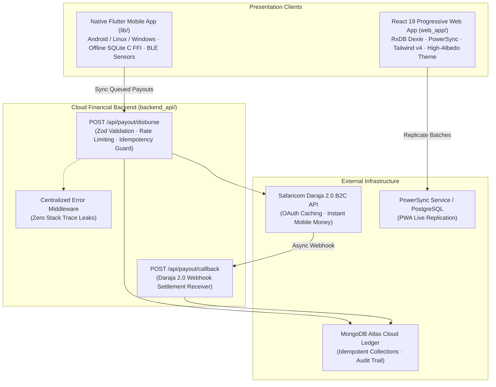

# KALRO Sericulture — Documentation Hub

Welcome to the centralized documentation directory for the **KALRO Sericulture Farm Management & Research Operating System**. Developed in alignment with the **Kenya Agricultural and Livestock Research Organization (KALRO)** and the **National Sericulture Research Centre (NSRC)** in Thika, this repository digitizes the full sericulture value chain across mobile, web, and serverless cloud financial platforms.

---

## 📚 Documentation Index

| Document | Scope & Focus | Primary Audience |
|---|---|---|
| **[Master Project Documentation (`PROJECT_MASTER_DOCUMENTATION.md`)](./PROJECT_MASTER_DOCUMENTATION.md)** | **Exhaustive 18-Section Technical Manual** Institutional context, tri-part architecture, Kenyan germplasm registry, 5-instar feeding schedules, 4-stage hot-air drying, defect grading, biosecurity triage, financial settlement, Dijkstra formula engine, C FFI SQLite indexing, RxDB offline sync, Node Best Practices, codebase tour, and deployment. | System Architects, Lead Engineers, Station Directors |
| **[System Architecture & Agronomy Guide (`OVERVIEW.md`)](./OVERVIEW.md)** | **Domain Science & Architectural Overview** Biological lifecycle curves, heterosis math, 11 characterized mulberry varieties, 7 castor varieties, 98 evaluation accessions, drying temperature profiles, and multi-tier system diagrams. | Research Agronomists, Extension Officers, Domain Specialists |
| **[Web Application Architecture (`web_app.md`)](./web_app.md)** | **React 19 PWA & RxDB Offline Layer** Bulletproof feature-based architecture (`features/batches`, `features/agronomy`, `features/finance`, `features/health`), RxDB on Dexie (IndexedDB), PowerSync live PostgreSQL replication, Tailwind CSS v4, and Executive High-Albedo theme. | Frontend Engineers, UI/UX Designers, PWA Specialists |
| **[Cloud Backend API Guide (`backend_api.md`)](./backend_api.md)** | **Next.js 15 App Router & Daraja 2.0 Payouts** Node.js Best Practices, strict Zod boot-up secrets guard, centralized error handling, sliding-window rate limiting, database-level idempotency protection, and automated test suite. | Backend Engineers, DevOps, Financial Auditors |

---

## 🏗️ Tri-Part Platform Summary

---

## 🧪 Quality Assurance & Test Verification

| Platform | Test Suite | Command | Verification Status |
|---|---|---|---|
| **Flutter Mobile Client** | 125 Automated Unit, Widget & SQLite Tests | `flutter test` | **100% PASSED** (125 / 125) |
| **Cloud Backend API** | 5 Security & Idempotency Test Groups | `npm --prefix backend_api test` | **100% PASSED** (All groups) |
| **React Web PWA** | TypeScript Check & Vite Production Build | `npm --prefix web_app run build` | **100% PASSED** (1.42s build time) |

---

## 🚀 Quick Navigation Links

* Return to repository root: [Repository README (`../README.md`)](../README.md)
* Flutter mobile source code: [`../lib/`](../lib/)
* React web dashboard source code: [`../web_app/`](../web_app/)
* Next.js 15 backend source code: [`../backend_api/`](../backend_api/)
